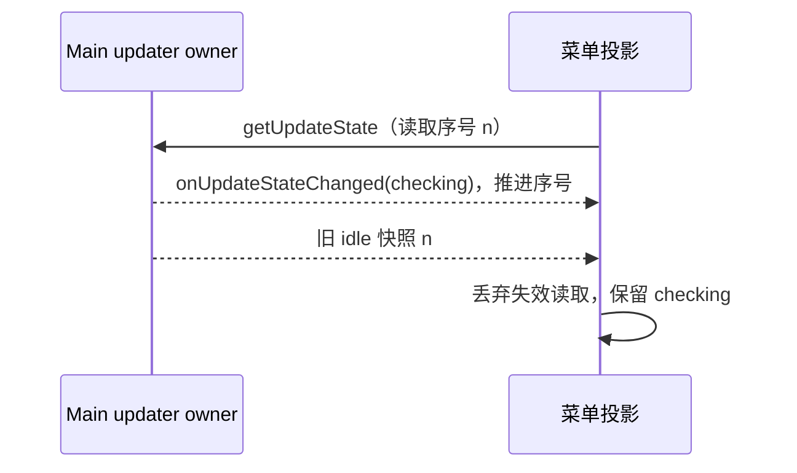

# Update Button Release Notes Hover

## 背景

桌面端自动更新下载完成后，左上角更新按钮只展示“可安装更新”的入口。发布链路已经把单版本 changelog 注入到 update feed 的 `releaseNotes` 中，但 renderer 当前不会在按钮 hover 时展示这份内容。

## 目标

- 更新按钮 hover 时展示当前正在下载或可安装版本的更新日志。
- 展示内容跟随界面语言：`zh-CN` 优先展示中文 changelog，`en-US` 优先展示英文 changelog。
- 不改变自动检查、下载、安装更新的主流程。
- 不在 hover 时新增网络请求，避免 update feed/CDN 状态影响 UI 响应。

## 设计

CI 收集桌面产物时继续保留 electron-updater 兼容的 `releaseName` / `releaseNotes` 字段，同时在 update YAML 中追加 `releaseNotesByLocale`。该字段包含 `zh-CN` 与 `en-US` 的标题和 Markdown，供新版本客户端直接从 `update-downloaded` 事件 payload 读取。

main 进程在 `update-available` 时就把多语言 release notes 规范化为 `PostUpdateReleaseNotesPayload.releaseNotesByLocale`，并随 `update-available` / `download-progress` 状态广播给 renderer；下载完成后继续随 `update-downloaded` 状态广播，并持久化给安装后弹窗使用。旧的 `onUpdateReady(version)` 事件只保留兼容用途，按钮展示详细内容以 `UpdateStatePayload.releaseNotes` 为准。

main 进程会把 electron-updater 当前读取到的 manifest 作为 `zh-CN` 内容；需要补齐英文说明时，会用同一个服务端 manifest 接口再次拉取并合并为 `en-US` 内容。补充请求沿用当前 `platform` / `device_mid` / `channel` 查询参数和 `X-Platform` / `X-Release-Channel` / `X-Device-Mid` header。这个补充读取只影响 release notes payload，不参与版本判断、下载 URL 解析或安装包校验，避免改变自动更新主流程。

UI 层复用现有 tooltip 与 Markdown 渲染能力：没有 release notes 时保持原来的短 tooltip；有 release notes 时，hover 下载中按钮或更新按钮展示一个紧凑的浮层，标题固定显示当前语言下的 `v{version} 更新日志` / `v{version} Release Notes`，标题下方仅显示按当前语言格式化后的 feed `releaseDate` 日期，不额外加“更新日期”或 “Release date” 前缀，正文渲染对应 Markdown。若当前语言没有对应内容，则回退到 payload 的默认 Markdown。按钮可见短文案、aria label、确认弹窗与下载中提示都走 i18n。

## 验证

- YAML 注入测试覆盖 `releaseNotesByLocale`。
- 自动更新 main 进程测试覆盖 `update-available`、`download-progress`、`update-downloaded` 状态携带 release notes。
- UI 单测覆盖 hover tooltip 按当前 locale 选择中文/英文 Markdown。
- main 进程测试覆盖默认 feed 与英文 sibling feed 合并后随状态广播给 renderer。

## 2026-10-21 上游整合：状态读取时序

Windows 合并菜单沿用 Main updater 的单一状态所有者。Renderer 的菜单状态只是投影：订阅推送优先于更早发起的 `getUpdateState`；后发读取使旧读取失效。卸载或平台切换后，旧读取不能提交到新菜单。菜单打开或检查命令完成后仍通过同一读取路径刷新，不另建 updater 或定时补偿。

验收：组件挂载后推送 checking，迟到 idle 不回退；卸载取消订阅；缺少 updater 能力时不读取/订阅；版本与下载进度参数保持原文案合同。对应 `packages/ui/test/useDesktopUpdateMenu.test.ts` 现直接覆盖真实菜单组件，已移除的 hook 不重新引入。
