# UWork 代码开发使用手册

从第一个项目，到每天接着开发。

适用版本：**UWork 3.16.7 桌面版**。可在登录页最下方查看客户端版本；安装包见 [GitHub Releases](https://github.com/Jas0nxlee/UWork/releases/latest)。本文于 2026 年 10 月 21 日按当前 `uwork` 源码（`a4485d6d`）核对说明。登录与扫码阶段图为本次拍摄；其余沿用 3.16.6 的已脱敏历史截图，作为操作位置参考，具体来源见文末。

**日常只需记住这条流程：打开项目 → 说清需求 → 检查改动 → 运行验证 → 保存进度。**

也可以打开本目录的 [离线图文版](index.html)，点击截图放大阅读。

## 1. 第一次打开：扫码登录，自动获取账号与用量

### 选择公司，用企业微信扫一扫

1. 打开 UWork，先核对页面底部的 **客户端版本**，再选择自己所属的公司。公司列表由管理员配置；截图中的 **北京、南京** 为测试示例，以自己安装包显示的选项为准。
2. 点击 **用对应公司企业微信登录**，等待二维码出现。
3. 在手机上打开 **企业微信 → 扫一扫**，扫描电脑上的二维码，并在手机上确认。等待 UWork 返回工作区。

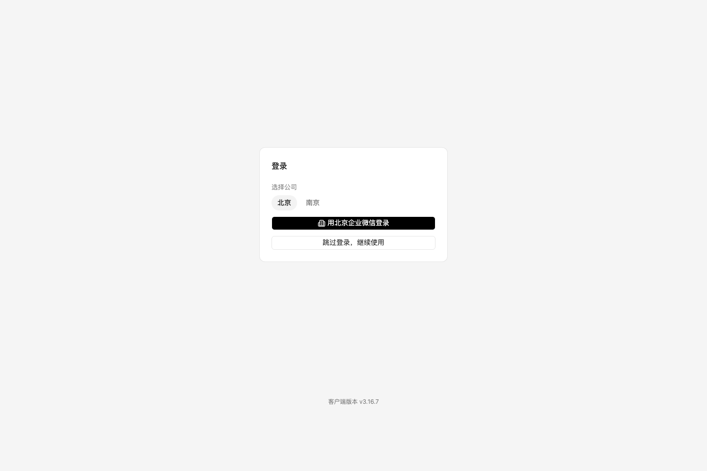

_3.16.7 登录入口 · 当前共享 UI 与隔离企业适配器的截图。公司选项决定本次扫码使用的企业应用，页脚显示构建版本。_

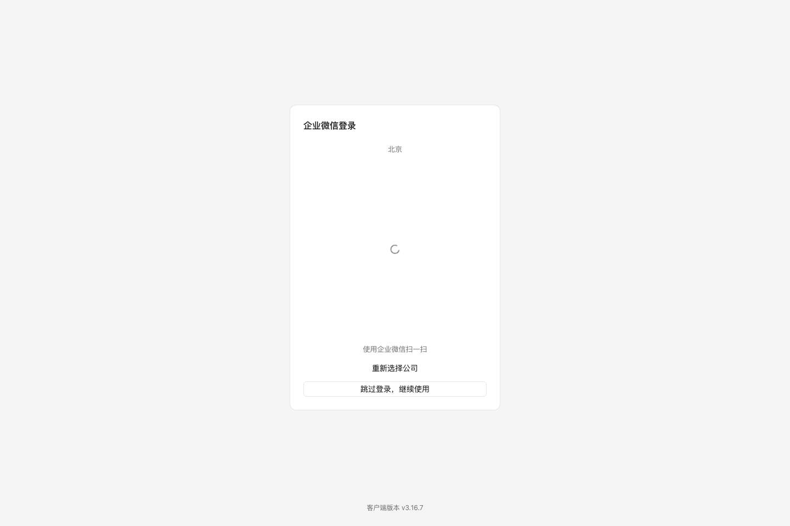

_3.16.7 扫码阶段 · 本图来自测试适配器，仅展示加载区域、重新选择公司和跳过入口，不包含真实授权二维码。正式客户端会在该区域加载企业微信页面，请扫描自己电脑上新生成的二维码。_

选错公司可点击 **重新选择公司**。如果暂时不方便登录，点击 **跳过登录，继续使用**；以后点击左上角 UWork 标志下的 **未登录 · 点击登录** 再进入。跳过登录后仍可使用自己配置的模型，但不会自动获取企业账号资料和企业用量。

### 登录成功后，会自动准备什么

UWork 会读取企业后台授权返回的信息，并尝试完成模型服务配置：

| 自动获取的内容     | 在哪里看、有什么用                                                                                   |
| ------------------ | ---------------------------------------------------------------------------------------------------- |
| 姓名与所属公司     | 左上角显示姓名；点击姓名查看所属公司，以及后台返回的部门、职位。                                     |
| 用户详细资料       | **企业网关**中的**企业账号**卡片：姓名、部门、职位、邮箱、角色、月度预算。未提供的字段显示“未设置”。 |
| 模型服务与可用模型 | 自动配置 UCAS 网关，复用或生成企业 API Key，并补充套餐允许使用的模型。通常不用手工复制密钥。         |
| 套餐与用量         | 自动读取套餐额度、已用额度、重置时间，以及请求数、费用和 Token 等统计。                              |

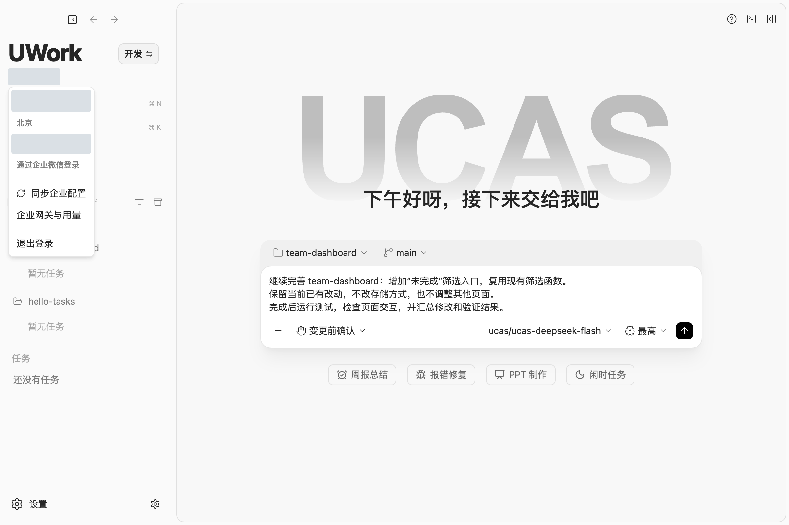

_登录后 · 点击左上角姓名，可以查看身份、同步企业配置，或直接进入用量页面。个人信息已遮盖。_

**已有本地 API Key 不会被自动覆盖。** 只有明确需要改用企业密钥时，才点击企业网关中的 **使用企业密钥替换**。自动补充模型也不会修改原有模型参数。

### 在哪里看套餐和实际用量

有两个入口：**点击左上角姓名 → 企业网关与用量**，或 **设置 → 使用统计 → 企业网关**。

- **企业账号**：核对是不是自己的账号，部门、职位等信息是否正确。
- **套餐**：看“已用 / 总额度”和“下次重置”时间。
- **用量**：选择 **近 7 天 / 本月 / 近 30 天**，再切换 **请求数 / 费用 / Token** 查看趋势和模型分布。
- **套餐模型**：查看当前可用模型；需要时点 **重新读取**，再点 **添加到模型列表** 补入缺失项。

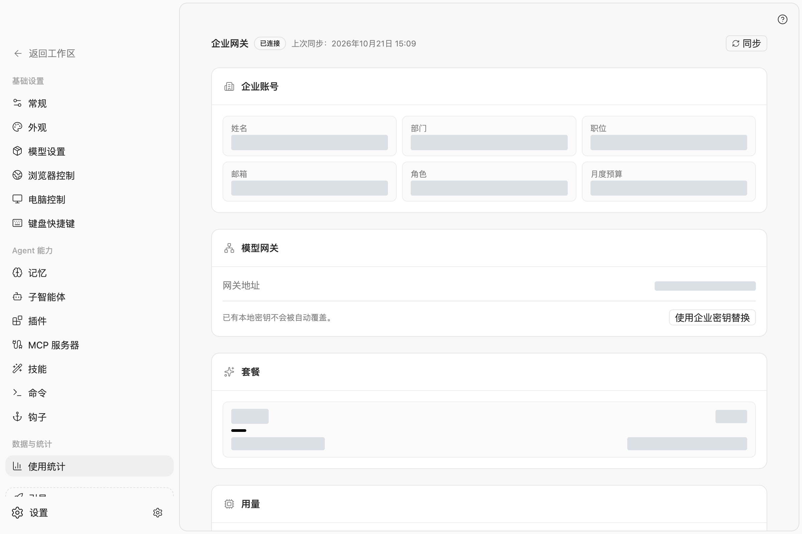

_账号与套餐 · 3.16.6 历史扫码后的已脱敏界面；本次未重新执行真实企业认证。个人信息、服务地址和具体额度已遮盖。_

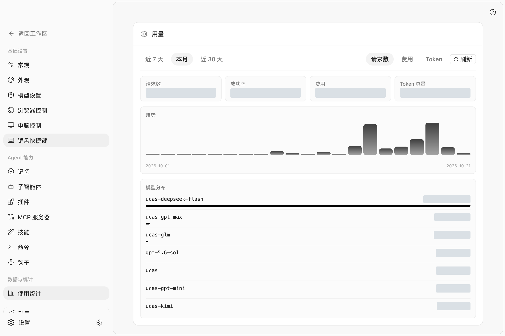

_查看用量 · 先选时间范围，再选指标；灰色遮盖块是手册脱敏处理，实际界面会显示数值。_

数据没更新时，点击页面顶部的 **同步**，或姓名菜单中的 **同步企业配置**；只想重查用量，点击用量区域的 **刷新**。请同时留意“上次同步”时间。费用和额度当前按美元显示。界面上的额度和用量来自企业后台，受统计周期和后台更新影响，不等于某一个项目的独立账单。

若显示“未登录企业账号”或“企业会话已过期”，重新登录再同步；若显示“同步失败”，先看网络和错误提示，不要把空白数据当作零用量。资料有误或套餐不符时，请联系企业管理员。

### 确认模型可用，再开始写代码

回到工作区，在输入框底部选择可用模型。首次使用可先发送一句简单问题，确认能够正常回复，再开始改代码。

若登录后仍提示缺少 API Key，按提示补充，或到 **设置 → 模型设置** 向管理员取得并填写密钥；暂时没有密钥可先选 **稍后设置**。模型未出现在列表时，可以点击 **自动获取**。看到模型名称，不等于该账号一定有调用权限。

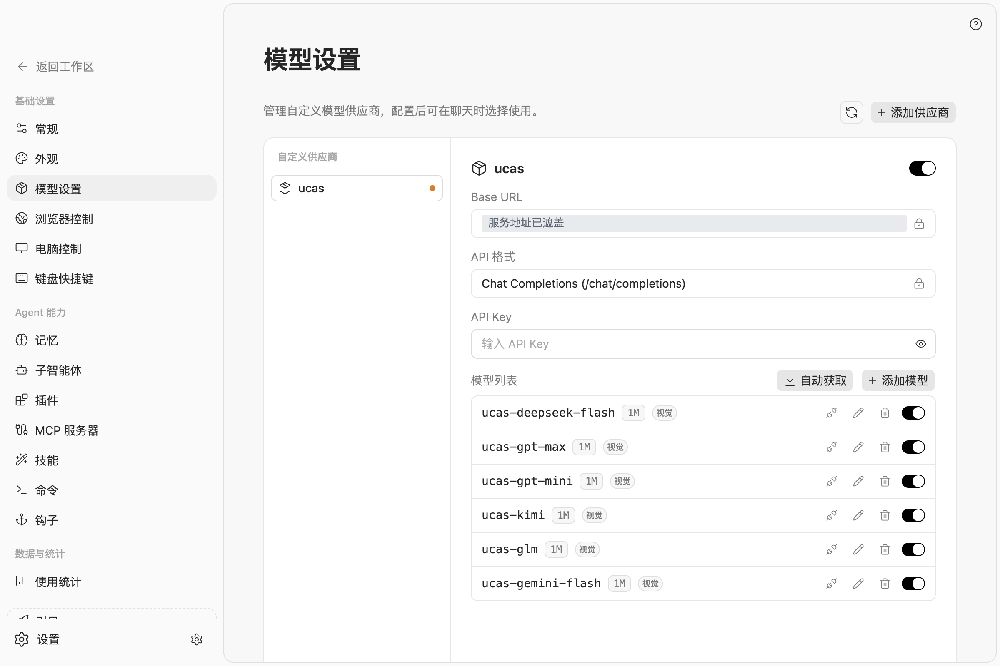

_模型设置 · 企业自动配置未完成或跳过登录时，可在这里补充配置。服务地址已遮盖，图中未填写真实密钥。_

左上角 UWork 字标旁建议选择 **编程模式**，便于查看命令、输出与代码变更详情；另一项是 **办公模式**，侧重操作摘要与结果。历史截图中的“开发”对应这里的编程界面。这个按钮只改变展示方式；是否允许修改文件，要看输入框底部的权限模式。

## 2. 创建一个新项目

### 第一步：准备一个空文件夹

例如在电脑上新建 `hello-tasks` 文件夹，用来存放待办事项网页的代码。

在 UWork 左侧找到 **项目**，将鼠标移到标题附近，点击 **添加项目（＋）→ 打开文件夹**，选择刚创建的文件夹。也可以从输入框上方的 **选择项目 → 打开文件夹** 进入。

打开后，确认输入框上方显示 `hello-tasks`。**项目是代码所在的目录；任务是围绕一个目标展开的对话。新建任务不会自动新建代码目录。**

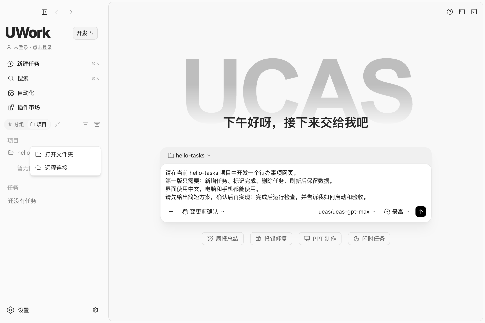

_新项目选空文件夹，已有项目选原来的代码目录，使用的是同一个入口。_

### 第二步：说明第一版要做什么

第一次不要把所有想法都塞进去。先做一个能运行、能检查的小版本。下面这段可以直接复制到输入框：

```text
请在当前 hello-tasks 项目中开发一个待办事项网页。
第一版只需要：新增任务、标记完成、删除任务、刷新后保留数据。
界面使用中文，电脑和手机都能使用。
请先给出简短方案，确认后再实现；完成后运行检查，并告诉我如何启动和验收。
```

如果已经确定技术栈，再补一句，例如“沿用 React 和 TypeScript”。不确定时，让 UWork 先给出建议和理由。

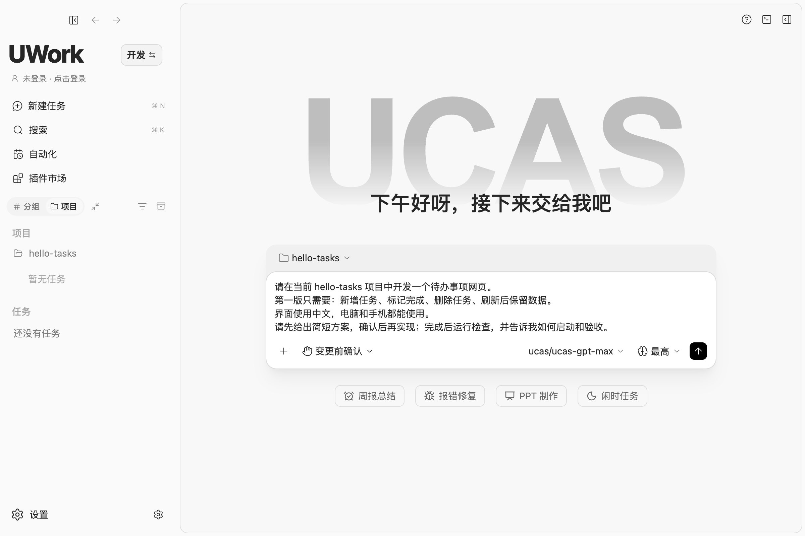

_发送前检查三处：上方的项目、下方的权限模式、右下方的模型。图中是尚未发送的示例需求。_

### 第三步：确认方案，再开始实现

点击输入框底部的模式按钮。刚开始用时，选 **计划模式** 或 **变更前确认** 即可。

| 模式       | 适合什么时候用                                 |
| ---------- | ---------------------------------------------- |
| 计划模式   | 需求还没想清楚，先看方案再实施。               |
| 变更前确认 | 希望改文件前先确认，便于熟悉项目。             |
| 自主模式   | 需求明确，希望在遇到风险时再询问。             |
| 完全访问   | 不再逐项确认操作；使用前先明确任务范围和风险。 |

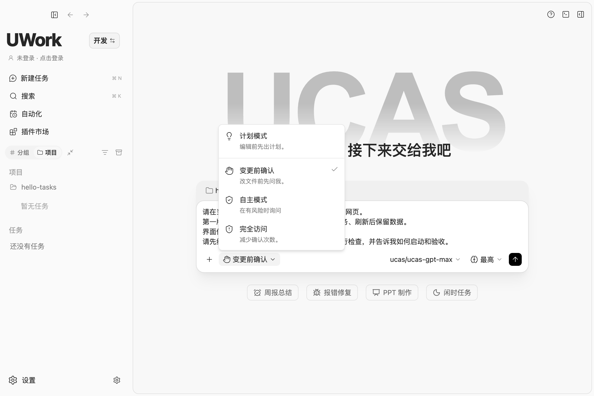

_“编程/办公”和这里的权限模式是两组不同的设置。_

点击输入框右下角的 **发送箭头**。方案合适后，可以继续说：

```text
按这个方案实现第一版。完成后列出修改的文件、实际运行的检查，以及启动步骤。
如果缺少依赖或运行环境，请明确告诉我缺什么。
```

出现待确认操作时，先看要执行的命令和涉及的文件。结果出来后，按第 4 节检查和运行。

## 3. 在已有项目上持续开发

### 先打开正确的项目，再了解现状

点击 **项目 → 添加项目（＋）→ 打开文件夹**，选择已有代码的根目录，通常是包含 `README`、`package.json`、`pyproject.toml` 或其他项目配置的那一层。

如果代码还只在 Git 仓库中，先克隆到本机，再打开克隆后的目录。打开项目不会自动拉取远端最新代码；多人协作时，先检查本地未提交改动，再按团队流程同步分支。远程工作区应同时确认连接的设备和项目，不要仅凭相同目录名称判断是同一工作区。

第一次接手一个项目，先发一条“只阅读”的任务：

```text
请先阅读 README、项目配置和主要源码目录，暂时不要修改代码。
告诉我：项目做什么、如何启动和测试、这次需求相关的代码在哪里。
检查当前 Git 改动，区分已有修改和后续要做的内容。
```

把鼠标移到左侧项目名上，点击 **查看文件**，即可浏览目录。点击文件可在右侧打开；点击 **返回任务** 回到任务列表。

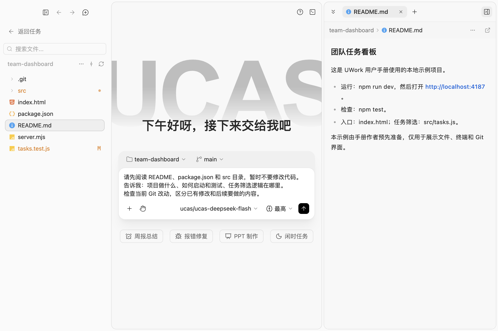

_左侧找文件，中间描述目标，右侧阅读内容。先读项目自己的启动说明。_

### 每次只推进一个清楚的目标

例如给现有看板增加筛选入口：

```text
继续完善 team-dashboard：增加“未完成”筛选入口，复用现有筛选函数。
保留当前已有改动，不改存储方式，也不调整其他页面。
完成后运行测试，检查页面交互，并汇总修改和验证结果。
```

给需求补上 **目标、范围、验收方法**，通常比“帮我优化一下”更有效。修复错误时，附上复现步骤、预期结果、实际结果和关键报错；需要补充材料，可用输入框的 **＋ / 添加上下文**，或输入 `@` 选择上下文。

## 4. 改完之后，做三件事

### ① 看改动：确认只改了该改的内容

点击右上角 **展开侧边面板**，选择 **审查**。如果右侧已经打开文件，点击标签栏的 **＋ → 审查**。

选择 **未暂存** 等对应范围，展开文件查看差异。重点看：修改的文件是否符合需求、有没有误删内容、是否混入别人的改动。绿色通常表示新增，红色表示删除。

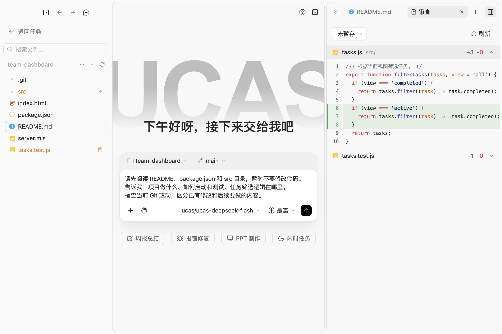

_示例新增了“未完成任务”的筛选逻辑；另一个变更文件补了对应测试。_

### ② 跑检查：看实际结果

点击工作区右上角的 **切换终端**，按当前项目 README 或配置文件中的命令运行检查。也可以要求 UWork 执行，并说明哪些通过、哪些失败。

不同项目的命令不同，不必照搬截图。图中的小示例使用 `node --test`，实际运行结果是 **3 个测试通过、0 个失败**。

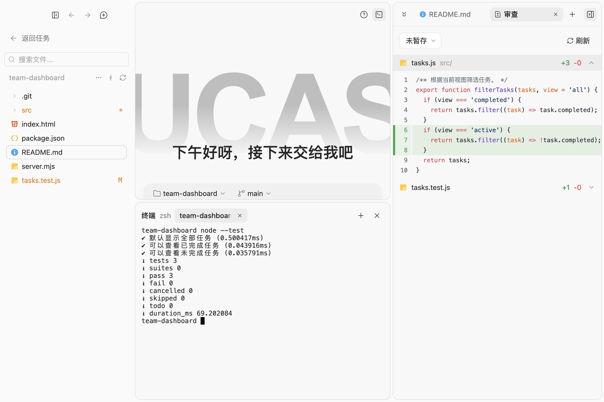

_看检查是否真的执行及其结果，而不只看回复里有没有写“已完成”。_

### ③ 打开页面：自己走一遍关键操作

按项目说明启动开发服务。打开右侧 **浏览器** 标签，在地址栏输入终端给出的本地网址；也可以在系统浏览器中访问。服务器需要保持运行。

至少试一遍这次新增或修复的操作。做待办网页时，就实际新增、完成、删除一条任务，再刷新确认数据是否保留。页面和逻辑都符合预期后，再进入下一轮。

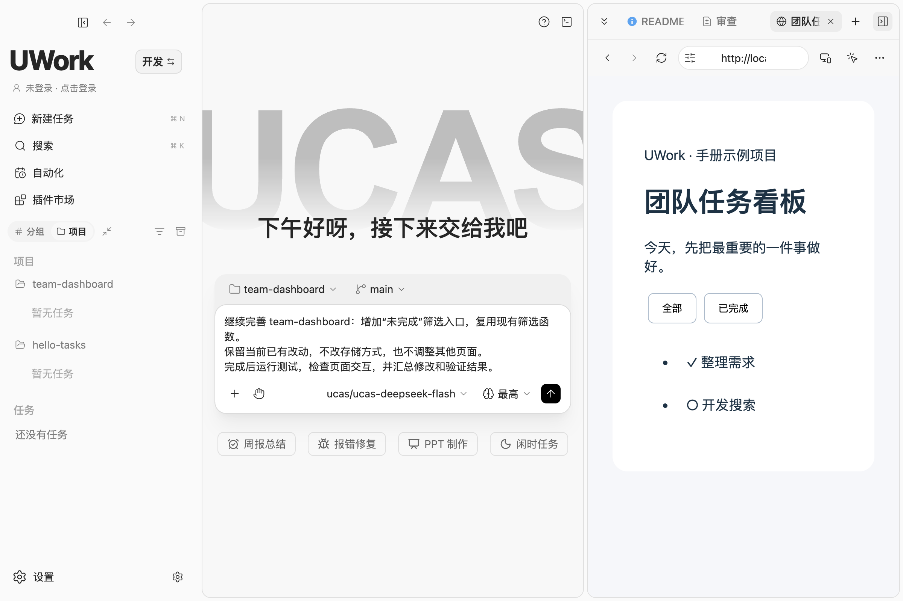

_一边看页面，一边描述下一步改动。图中预览的是预先准备的示例项目，“未完成”入口仍是待实现需求。_

## 5. 保存进度，第二天接着做

**同一件事的后续修改**，打开原任务接着对话；**新的功能或另一项问题**，在同一项目下新建任务，并确认输入框上方仍是正确的项目。

结束前可以让 UWork 整理一份短交接：

```text
请总结本次完成了什么、改了哪些文件、哪些检查已通过、还剩什么。
把下一步需要的背景写到项目文档中，方便下次继续。
```

使用 Git 的项目，检查通过后保存一次小而明确的提交。可以明确要求：

```text
请先检查 Git 差异，只提交这次任务相关的文件。
不要包含原有的无关改动。提交后告诉我提交编号，暂时不要推送。
```

**本地提交与推送到远端是两步。** 需要同步给同事时，再确认远端和分支并推送。对话记录不能替代 Git 版本记录。

第二天，先从左侧项目或搜索中找到原任务，再说：

```text
继续这个项目。先核对当前文件、Git 状态和上次记录，再说明下一步。
今天只处理“未完成”筛选入口，不扩展其他功能。
```

## 6. 当前版本的 Office 与手机远控

- **Office 文件**：应用内可预览 Word、Excel 和 PPT；是否允许编辑由格式、大小及内容护栏决定。复杂结构可能保持只读，保存时仍需检查差异和备份，不能把“能够打开”当作任意复杂文档都能完整编辑。
- **Word 修订审阅插件**：`office-editor` 提供修订、批注与审阅入口。默认未配置外部引擎时显示只读预览；不要把只读预览误认为已启用完整编辑器。具体配置见 [插件说明](../../plugins/office-editor/README.md)。
- **手机远控**：先由管理员配置可信的 relay 与手机页面地址，再从桌面配对。手机连接桌面已有的工作区和任务，不会自动创建第二套会话。自建 HMAC 配对与企业微信登录是两条独立链路；没有 relay 配置时，单靠扫码登录企业账号不会获得手机远控。见 [远控配置与协议](../../specs/web-remote-control-relay.md)。

## 7. 遇到问题，先看这里

| 遇到的情况             | 先做什么                                                                     |
| ---------------------- | ---------------------------------------------------------------------------- |
| 版本与截图不同         | 先查看登录页底部版本；升级安装包后再按当前说明操作，历史截图仅参考入口位置。 |
| 没有可用模型、发送失败 | 到模型设置检查 API Key、模型启用状态和服务权限；按界面错误提示排查。         |
| 改错项目或找不到文件   | 核对输入框上方的项目名，用“查看文件”检查目录；必要时重新打开项目根目录。     |
| 一直等着不动           | 看是否在等权限确认、计划确认或补充信息；若有错误，保留关键提示再重试。       |
| 测试失败或页面打不开   | 提供实际命令、完整错误和本地网址；先确认服务在运行、端口正确，再定位原因。   |

**一个实用习惯：每完成一个小目标，就看一次差异、跑一次相关检查，再继续下一步。**

---

截图与验证说明：登录入口、扫码阶段两张图由当前 3.16.7 共享 UI 配合隔离的企业测试适配器拍摄，不包含真实授权二维码、账号或密钥。其余 11 张图沿用早前 3.16.6 的 macOS 截图；企业资料与用量图片是历史真实扫码后已脱敏的界面，本次未重新验证真实登录或企业后台。历史图片中的 `hello-tasks` 是空目录，`team-dashboard` 是作者准备的本地示例，输入框中的需求均为未发送草稿；终端“3 项通过”只属于该示例项目，不代表当前 UWork 测试数量，也不是 AI 完成开发的证明。本次未发送真实模型对话。逐图版本、来源与 SHA256 见 [截图清单](capture-manifest.json)。
