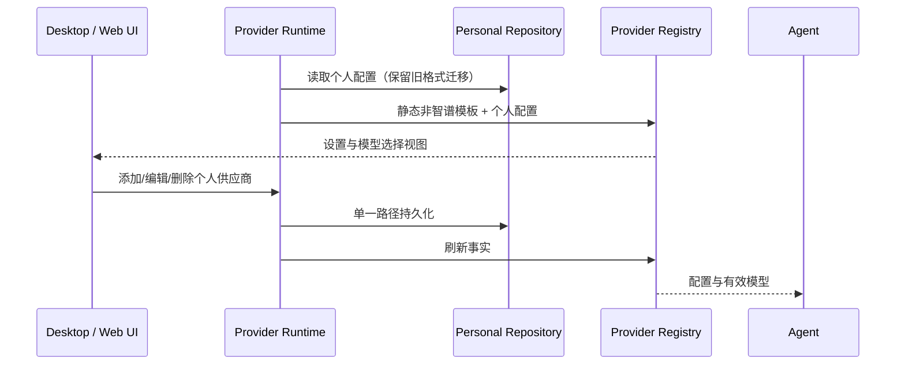
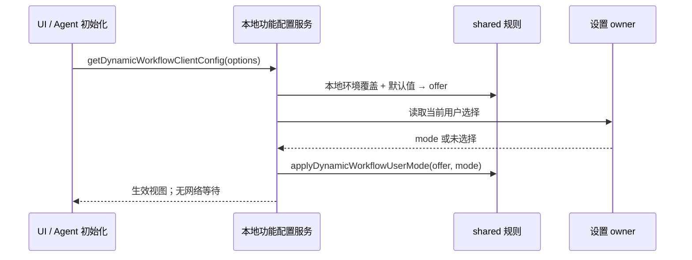

# 本地自定义供应商版本

企业身份登录后续按 [enterprise-identity.md](enterprise-identity.md) 独立新增，可跳过；下文退役的账号仅指原模型供应商账号。企业登录不恢复旧 OAuth、套餐或模型账号服务。

公开 Web 会话分享页保留独立的历史 Z.ai / BigModel 认证入口：私有分享的 owner 与服务端访问令牌仍按这两个账号域判权，删除入口会使既有私有分享不可访问。此例外仅用于 `/share` 的读取与导入，不进入 Desktop/Web 工作区模型供应商、套餐或通用账号 UI；未来迁移分享服务鉴权时须单独设计数据迁移及授权兼容。

## 产品规则

移除应用登录及智谱/Z.ai 内置供应商（BigModel、Coding Plan、Start Plan、团队与闲时套餐）。保留 UCAS 作为唯一随包默认供应商：其配置写入 Personal Provider Repository，不使用账号认证或远端配置刷新。启动直接进入工作区；UCAS 默认可用，其他供应商仍可通过模型设置添加。模型设置、模型选择与页脚不展示账号、登录、订阅或升级入口。

保留现有个人供应商、API Key、模型、排序、工作区和会话。用户手工填写的 API 地址不按域名封禁。内置推荐模板保留非智谱供应商；智谱内置模板及账号 Provider 不再播种。历史登录凭据保留在磁盘以便回退，但不会恢复、刷新或用于账号 API 请求。

## 所有者与边界

- Personal Provider Repository 唯一拥有用户供应商配置；UCAS 从本地模板原子播种。历史 ID 为 `ucas` 或显示名为 `ucas` 的个人记录会合并到固定模板，固定名称和连接字段，保留 API Key、已有模型配置与排序。Provider Registry 发布设置与模型选择视图。
- Host 只从随包静态模板和 Personal 配置组装 Registry，不读取旧 CDN active 缓存，不注册远端内置配置刷新。
- OAuth RPC 保留兼容边界：读取恒为 signed-out，登录/刷新明确失败，回调不接收账号，不发网络请求。
- 套餐 RPC 返回明确退役错误，Start Plan 和强制更新查询为空；动态工作流只读本地覆盖与现有默认值，不再查询 client/configs。
- OAuthCredentialRepo 的历史账号读取停用；credentialService 隔离 oauth:、account-provider: 和 zcodejwttoken 的历史读取；自定义 API Key 不变。
- UI 通过现有 hooks/facade 编辑供应商；页脚只保留偏好菜单与设置按钮。
- UCAS 空白页水印在浅色主题使用可见实心文字，在深色主题沿用渐变资源；分享页 UWork 字标可做轻微脉冲，但尊重系统减少动态效果设置。
- 清理已经没有产品入口的旧登录组件、强制更新提示、套餐和额度组件；调用方不再向共享侧栏页脚传递已弃用账号/套餐 prop。仅删除静态引用图中不可达的源码，保留独立 Web 分享鉴权及现有兼容 RPC。
- Desktop 连续流、手机恢复流、owner/lease、workspaceIdentity 与远程鉴权均保持现有协议。

## 验收

### 2026-10-18 推送门禁回归

远程 workspace Host 的集成测试遵循同一退役合同：历史个人/团队 OAuth 凭据不能恢复登录、换取 PAT 或触发订阅请求；已存在 Local Host owner 时也不能由恢复/套餐 RPC 重新激活。保留四种 family/plan 组合的凭据不可用、重试与无网络断言，不把已退役链路重新实现为成功路径。远程文件/Agent 服务与个人 API Key 的正常使用继续验证。

1. 带历史 OAuth 凭据启动：无账号展示、无登录页，不请求登录/套餐/权益 API。
2. 新安装且无自定义供应商：工作区可打开，模型设置可添加供应商；不强制登录。
3. 设置展示个人供应商及唯一的 UCAS 默认供应商；UCAS 地址和 API 格式固定，只允许保存 API Key 和模型配置。其他供应商的添加、保存、排序、删除和模型编辑继续通过现有 facade。
4. 历史自定义配置保留；刷新和重启不恢复智谱内置 Provider。
5. OAuth RPC 及旧回调不能重新启用账号功能；自定义 API Key 保持可读。
6. 执行 Node 测试、typecheck、lint、architecture 检查；Electron E2E 检查设置页面和添加供应商，重建安装并保留旧 app 备份。

## 范围

本次移除账号和智谱内置模型供应商服务，仅保留 UCAS 默认供应商，不删除远程 workspace 的连接鉴权，不改用户手动配置的模型服务。模型设置中的“添加供应商”初始呈灰色；在同一次页面挂载期间连续点击 20 次解锁，其他点击会重置点击序列。官方自动更新需在本地定制版本停用，避免重新覆盖本次移除行为。

## 上游同步后的本地功能配置（2026-10-14）

Host 的动态工作流配置不能依赖智谱 `client/configs`。每次读取从本地 `ZCODE_DYNAMIC_WORKFLOW_MODE` 与 shared 默认值构造 offer，再通过 shared 的 `applyDynamicWorkflowUserMode` 应用当前设置；`forceRefresh` 保留接口兼容，但不触发网络。Settings 继续拥有用户选择，服务只发布派生视图，不另存选择或远端快照。

Agent 按现有生命周期缓存本地 offer，并在使用时读取最新用户选择；Desktop 和远端 Host 使用同一工厂，手机只读取已有 Host 视图。此修复不改 continuous/replayable、attachment、workspaceIdentity 或 owner/lease。无本地覆盖时保留默认关闭；合法覆盖与用户切换仍生效，任何配置查询都不读取历史账号凭据或访问套餐端点。

验收：注入立即失败或永不完成的 ApiClient，默认配置和覆盖配置仍立即返回，网络请求数为零；重复读取可观察用户选择变化，`forceRefresh` 不改变本地来源。现有套餐退役边界和新增兼容 RPC 继续遵循产品规则。

## 2026-09-23 验证记录

- 服务端 15 项、UI 6 项 Node 测试通过；新增退役测试先失败后通过。
- `pnpm typecheck`、`pnpm architecture:check --changed`、改动文件格式检查通过；`pnpm lint` 为 0 错误、57 警告。
- Electron E2E 在隔离数据目录中验证无登录/内置供应商、自定义供应商创建、密钥/模型保存与刷新。
- 额外 `tsc -p packages/desktop/tsconfig.main.json --noEmit` 有 83 项错误；与原始 main 文件对比，无新增诊断。该入口并非根 typecheck 的组成部分。
- `.app` 本体的主进程、Host、Renderer、关键依赖、Agent、原生辅助程序和空内置供应商目录验证通过；本机临时签名通过深度严格校验。
- DMG 包装步骤发生 `plistlib.InvalidFileException`；安装直接使用校验通过的 `.app`，没有将 DMG 报为成功。
- 安装后实际设置页确认个人供应商仍在、账号供应商消失；供应商配置、旧配置、凭据文件的安装前后 SHA-256 一致。
