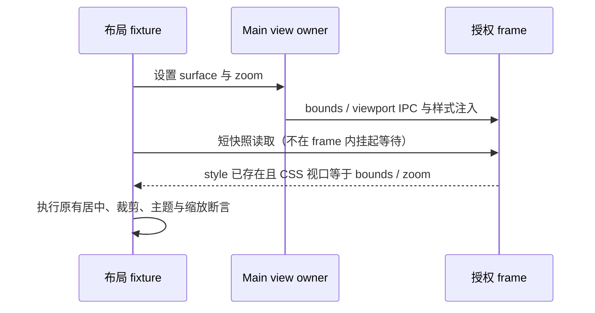
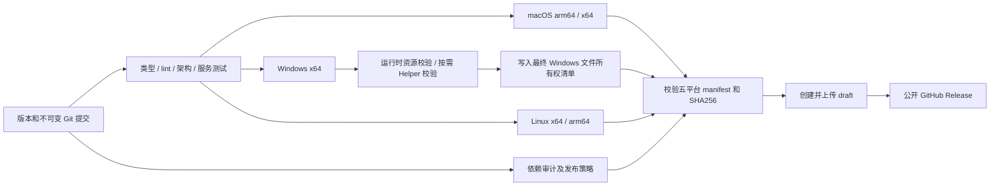

# UWork GitHub 多平台发布

## 发布规则

- 发布目标为用户 fork `Jas0nxlee/UWork`，默认分支 `uwork`；正式客户端身份为 `UWork` / `dev.zcode.app`，构建显式使用 `ZCODE_ENV=production` 和 `ZCODE_PREVIEW_IDENTITY=0`。
- 首次配置以 `v3.14.4` 发布，版本由根 `package.json` 提供。已有标签不移动，不覆盖其他版本的 Release。
- 本轮修复以 `v3.14.5` 发布：登录恢复与取消、子进程崩溃归类、Linux 历史桌面项、UCAS 验收地址及发布 tag 门禁。Release 说明列出用户可见修复与仍需每台设备单独放置的企业身份公开配置。
- 下一版 `v3.14.7` 修复新设备企业微信按钮禁用：五个平台构建均从 GitHub Actions 加密配置注入默认公开参数，随包资源必须通过严格字段校验和内容一致性校验。安装后无需复制配置文件；保留本机覆盖与用户凭据隔离，并发布本次 UCAS Key 引导。`v3.14.6` 构建因新增 Linux 启动测试误用可执行文件名而未发布，标签保留。
- 本次发布为 `v3.15.0`：包含企业网关自动配置、套餐/用量展示、独立 UWork 数据目录、目录规则测试与依赖安全修复。根版本是唯一版本所有者；发布说明从 `docs/releases/<version>.md` 读取，不继续复用上一版硬编码的变更说明。缺少当前版本说明时汇总失败，不发布。
- `v3.15.0` 升级说明必须明确：用户级数据改为 `~/.uwork`，不迁移或删除 `~/.zcode`；首次升级可能需要重新登录与配置。未保存 issuer 的历史 MCP OAuth 凭据刷新时需重新授权。调试 forge 固定到尚未正式发布的上游安全修复提交；历史许可原文缺口保持待复核标记，不声称材料已经全部核验完成。
- `v3.15.0` 未公开发布：干净环境的共享 `node_repl` 主机构建引用未声明的旧 MCP SDK 类型而失败。保留该标签，修正版使用 `v3.15.1`；Computer Use bridge 的 `CallToolResult` 从主机已声明的 `@modelcontextprotocol/server` 公共入口读取，不恢复旧 SDK 或依赖 hoist。桥接协议、能力令牌、工作区身份和代际校验保持原实现。检查阶段新增完整桌面 Agent 构建，覆盖 CLI 依赖顺序、主机类型与 runtime 产物，在进入平台打包前拒绝缺失模块。
- `v3.15.1` 产物校验发现新 ASN.1 依赖的 `pvtsutils` 未进入 app.asar：打包注入与最终校验维护了不同闭包根清单。保留该标签，发布版本改为 `v3.15.2`；两阶段统一消费 `desktop-asar-runtime-modules.mjs` 的唯一不可变清单，使用现有递归依赖解析，不逐个手工补叶子包。移除无用的 forge 注入根，保留 telemetry、ZIP、SSH 与 updater 的既有边界。CI 使用真实 ASAR 注入/解包及隔离 Node 进程验证 ASN.1 库能解析和加载，禁止靠工作区 hoist 掩盖缺包。
- 包根解析必须略过仅声明 `type=commonjs` 的内部 package.json，向上找到具名包根，保留真实 exports 和依赖声明；不能把 `build/cjs` 或 `umd` 当成整个包复制。
- `v3.15.3` 修正 macOS DMG 的遗留品牌背景：普通与 Retina 素材均显示 `UWORK`，保持原安装拖拽布局。发布后核对实际 macOS arm64/x64 DMG 内的 `.background.tiff` 与本次素材一致；不覆盖已经公开的 v3.15.2 文件。
- `v3.16.0` 发布原 PR #2/#3 与审查修复：公开 SkillHub 技能源、受信市场绑定、统一 UWork CLI/MCP/Agent 数据根、完整目录迁移以及多组织登录的并发与持久化修复。只有最新 PR head 经检查、复核并合入 `uwork`，且最终合并结果通过检查后才创建新版本标签。
- `v3.16.1` 发布上游同步后的集成修复、原生登录配置与回调归属、企业身份变更下的网关写入校验、HTTP 绑定鉴权、子 Agent 配置隔离和 CLI 日志保留窗口修复。版本提交仅包含根版本、发布说明及本契约，保留无关本地改动；正常 pre-push hook 通过后推送分支与不可变标签，沿用五平台构建、启动检查、依赖审计与完整 Release 汇总门禁。
- `v3.16.1` 的 Windows 构建因 Git 换行转换破坏固定资源哈希而失败，未公开 Release；保留失败标签。`v3.16.2` 包含相同功能修复和原始字节检出规则，完整性与五平台发布门禁不变。
- `v3.16.2` 未公开：Windows 生产 fuse 与旧 Playwright Electron 启动通道不兼容；`v3.16.3` 保持正式包安全设置，使用 Chromium CDP 验收原始产物，原生 view 归属由独立 fixture 验证，保留前序标签及失败证据。
- `v3.16.3` 未公开：Linux fixture 缺少与既有安装包测试一致的启动参数，且真正的安装包验收捕获 Main 登录 IPC 漏导入造成的同步错误框。`v3.16.4` 修复接线并执行真实回调回归，保持所有五平台构建、原始资源校验和安全设置。
- `v3.16.4` 未公开：Windows 正式包功能验收通过，但私有目录清理遇到 EBUSY；Linux ARM64 原生 fixture 在视口就绪前测量几何。`v3.16.5` 加入有限文件删除重试与视口事实检查，保留原断言、前序标签及五平台完整发布门禁。
- `v3.16.6` 修复首页深色主题误引用上游 Z 标识的品牌回归，恢复现有 UCAS SVG。发布检查必须执行 `v4ConversationDraftEmptyStateLogo.test.ts`，覆盖桌面与手机紧凑布局的深浅主题资源，禁止仅凭品牌 data 属性判断正确。保留 v3.16.5 及既有五平台构建、启动、签名和完整性门禁。
- `v3.16.7` 发布 PR #6/#7/#8 的合并修复、登录页构建版本、Office 与自建 HMAC 远控兼容、安全依赖及双语说明修正。保留 `v3.16.6` 和既有标签；根版本是唯一版本所有者，同时重生成第三方输入清单。五平台安装包的真实 Renderer 必须显示与根版本一致的登录页版本，再继续原有扫码与取消验收；不使用源码夹具替代安装包事实。版本展示不引入认证或更新网络请求。
- 打包身份配置兼容现有单组织公开配置，不凭客户端支持多组织宣称三个组织已经启用。stage 成功后仅记录规范化配置的组织数量，不输出组织标识、地址、配置内容或凭据。数量证据来自当前构建的日志。
- 发布说明须明确公开 SkillHub 使用匿名下载，不能代表组织私有技能授权；多租户生产启用仍依赖服务端组织绑定唯一约束、空 Host 拒绝和 review 组织归属校验等前置项。客户端发布不是生产企业验收，本次不实施独立后端仓库的改造。
- 隔离启动测试与正式打包共用 `resolveDesktopProductIdentity` 的程序名；Linux 的兼容内部程序名保留，不依据可见 UWork 品牌猜测路径。
- `uwork` push / PR 执行 lint、typecheck、架构与相关服务测试；版本标签或手工工作流执行五个原生构建：macOS arm64/x64、Windows x64、Linux x64/arm64。Node/pnpm 分别遵循 `mise.toml` 和 `packageManager`，Actions 固定完整提交 SHA。
- 构建复用现有 `bundle.mjs`。桌面安装包不依赖远程 mock CDN，CI 使用 `ZCODE_SKIP_REMOTE_ASSETS=1`，保留本地 Agent、插件、原生搜索工具、依赖闭包和平台校验。依赖和 Electron 从公开官方来源获取；随包企业身份配置仅接受公开字段，个人凭据不进入产物。
- Electron runtime 版本唯一读取 `packages/desktop/package.json` 的固定版本，开发、测试、安装包及 Windows Helper 校验不得另行硬编码。打包配置必须能在未暂存企业身份配置时正常加载；配置存在时从 `.release-config/enterprise-identity.json` 复制到 `resources/config/enterprise-identity.json`，设置 `UWORK_REQUIRE_ENTERPRISE_IDENTITY_CONFIG=1` 而配置缺失时在打包开始前拒绝构建。
- Gen UI 的固定哈希资源（visualize assets 与受 runtime manifest 引用的 tweak runtime）按原始字节检出；Windows `core.autocrlf=true` 不能改写换行。完整性校验仍比较原始 SHA256，不归一化内容、不更新哈希去适配损坏资源。回归通过真实临时 Git index 和 Windows 换行配置检出全部受清单约束的文件，再逐一校验哈希。
- 隔离安装包启动检查输出阶段标签，首次功能断言失败必须在清理前记录，不能由 Electron 关闭等待遮住原错误。校验步骤最多运行 10 分钟，到期失败；不以强杀后继续通过代替正常退出或功能验收。CI 启用 Playwright API 诊断以定位启动/页面/原生视图边界，不输出企业配置或凭据。
- 正式 Windows 包保持 `enableNodeCliInspectArguments=false`。安装包测试用子进程启动未改写的产物，经 Chromium CDP 连接真实 Renderer，不依赖 Playwright Electron 的 Node Inspector 通道。隔离目录同时覆盖应用数据、userData 与 sessionData；清理仅终止该测试自己启动的进程树，清理不是产品正常退出验收。真实安装包验证登录按钮、内嵌二维码 surface、新建与取消的授权 WebContents target、唯一 UWork 主页面；窗口归属与不新建 BrowserWindow 继续由同版本 Electron 的原生 view fixture 验证。测试不启用正式包 fuse、不增加产品调试接口，也不删除功能断言。
- 非特权 Linux CI 的原生 view fixture 与安装包验收使用相同的 `--no-sandbox` 测试参数，避免未配置 root-owned SUID helper 时在断言前退出；该参数不写入正式安装包或用户启动配置。其他平台不追加此参数。
- 测试进程树回收成功后，Windows 临时 Cookie 文件可能短暂返回 EBUSY。私有测试目录删除使用 `fs.rm` 的有限重试（10 次、200ms 线性退避），耗尽仍失败；不以固定等待或吞掉清理错误替代进程归属验证及功能验收。
- 原生 iframe 布局 fixture 先观察其 CSS 视口与实际 view bounds / zoom 一致，再执行原有几何断言；样式节点存在本身不是视口就绪证据。保留居中误差小于 2 像素、二维码/说明不裁剪和全部主题/宽度/缩放用例，不扩大容差。
- 原生 view fixture 在各平台完整安装包构建前运行，先验证快速的源码/平台接线；正式包 CDP 验收仍在打包后执行。任一阶段失败均保留发布阻断。

- Windows 的 `.zcode-install-manifest` 由桌面打包流程独立生成，记录最终安装目录内的程序所有权。Computer Use 使用开源占位包或真实 producer 都必须生成清单；只有 Helper 的资源准备与校验依赖 producer，不能让可选能力改变升级清理合同。
- macOS 输出 DMG/ZIP，Windows 输出 NSIS EXE，Linux 输出 AppImage/DEB/RPM/Arch 包。公开 CI 无开发者证书时使用明确启用的 macOS ad-hoc 签名并验证资源封印；不声称具有 Apple 公证或 Windows 发布者签名。
- macOS 的 ad-hoc 打包在签名前清理 appOutDir 中的 Finder/resource-fork 扩展属性；只处理当前生成的应用副本，不修改用户数据或原有安装。
- Linux 包保留发行格式的架构名称：x64 可为 x64/x86_64/amd64，arm64 可为 arm64/aarch64；manifest 使用统一 matrix 身份，汇总须识别对应别名。
- 按用户选择，正式发布的依赖审计必须拒绝 high/critical，上传完整审计报告。不为本次发布配置审计忽略项或允许失败。

## 所有者和事件顺序

- 根版本和 Git 提交唯一决定构建身份。平台 build job 只产生当前提交的安装包与带 SHA256 的 manifest；publish job 唯一拥有 Release 创建与公开操作。
- `electron-builder.config.js` 唯一持有企业公开配置的随包映射和 Windows 安装所有权清单；Windows `afterPack` 先完成运行时资源校验、按需完成真实 Helper 校验，再写入最终文件清单，随后才签名和生成 NSIS 产物。
- publish 必须等待检查、审计策略和全部五个平台构建完成。汇总时重新验证版本、提交、平台矩阵、必需文件和校验和；任一目标失败不发布完整 Release。
- 构建 job 仅有 contents read；publish job 才有 contents write。输入先校验，再通过环境变量和独立脚本传递，不把用户输入插入 shell 代码。
- 发布先创建 draft，再上传全部已核验文件，最后公开；重跑只能补齐同一版本、同一提交的 draft。已公开 Release 不自动覆盖。保留旧版本和本机替换前的 `.app` 备份作为回退路径。
- 手工 publish 只允许从 `uwork` 分支的当前提交执行。版本 tag 必须在发布前存在且精确指向当前提交；publish job 不创建或移动 tag。tag push 也必须满足 tag 与根版本一致、指向当前提交。

## 验收

1. 五个平台 workflow 实际运行成功，Release 包含所有必需格式、源码提交和 SHA256SUMS。
2. 文件被修改、缺少目标、版本或提交不一致时，汇总脚本失败且不发布。
3. macOS 安装副本的签名、版本和源码提交通过核验，主进程实际启动；Windows/Linux 分别记录构建及可用的运行验证，不能用 macOS 启动代替它们。
4. CI 的未执行、失败、依赖审计发现和签名限制如实记录。
5. 从其它分支手工 publish、缺失 tag、tag 指向另一提交或版本不一致均在创建 Release 前失败。
6. 打包配置在企业身份配置缺失且非必需时正常加载；配置存在时正确映射随包路径，必需但缺失时立即失败。Electron runtime 版本始终等于 desktop manifest 固定版本。
7. 开源占位 CUA 的 Windows `afterPack` 仍生成包含实际安装文件的 `.zcode-install-manifest`；真实 producer 完成 Helper 校验后也生成同一清单。
