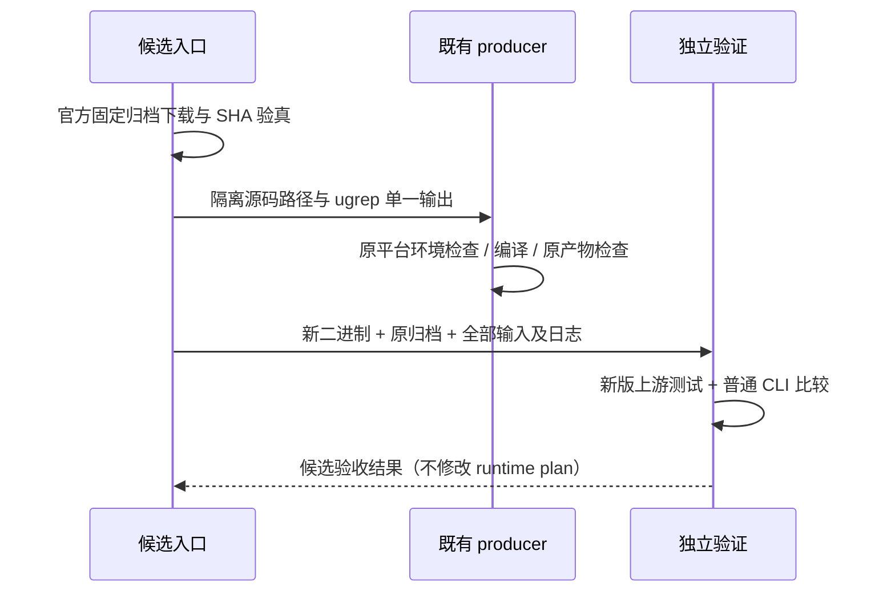

# 既有原生搜索 PCRE2 消费者维护

## 范围与所有者

现有 ugrep 7.8.4 producer 是六个平台构建规则的唯一所有者。候选入口只在
隔离目录准备原固定源码及官方 PCRE2 10.49，再调用该 producer；不修改运行时
release plan、摘要、仓库归档或发布内容。受影响的 Linux/Windows 两种架构需要
原生候选。Darwin 原有 ugrep 关闭 JIT，不扩大当前四目标 CI 范围。

官方输入沿用 `native-search-tools-config.mjs` 的源码身份，仅替换 PCRE2 项为
`public-windows-ripgrep-source.mjs` 唯一持有的 10.49 URL/SHA-256。每个输入必须
下载验真，再保留归档、提取后的许可原文及来源。不得任意覆盖其他源码身份。

## 产品与平台合同

- ugrep 保持 7.8.4、原固定提交、原 `-P:pcre2jit` 功能和全部现有压缩格式。
- Linux 构建仍要求 Node 24、glibc 2.28、GCC/G++ 12；静态链接第三方库、libgcc
  和 libstdc++，由已有 ELF/依赖/glibc gate 验证。Ubuntu 24 原生构建不能替代该基线。
- Windows 继续 MSVC 静态 release CRT、原架构及 PE 检查。候选保留源编译日志与
  导入/头信息；不接受关闭原检查、修改检测结果或伪造工具链声明。
- 先在新版 PCRE2 上执行官方普通 test suite，再比较旧/新 ugrep 的正常 CLI
  行为。Linux 还运行 ugrep `make test`。不构造漏洞利用或旧版触发程序。
- 旧版二进制只用于普通兼容命令；新输出须保留退出码、stdout/stderr、匹配位置、
  文件过滤和压缩内容搜索。版本/PCRE2 版本字符串按维护版本显式验证。

## remote Darwin 兼容路径

实际分发的两个 rg13 归档均为 Mach-O `minos 12.0`、仅依赖系统 libiconv/libSystem。
x64 的 PCRE2 10.32 启用 JIT，arm64 未启用。新的 rg14 POSIX 候选同样要求 macOS 12，
因此最低部署版本不构成统一 release plan 的障碍；行为兼容仍是独立验收前提。

`test-remote-ripgrep-compatibility.mjs` 是 rg13→rg14 普通行为比较的唯一入口。
复用 `public-ripgrep-compatibility.mjs` 的 11 项普通场景，追加当前调用使用的
hidden/no-ignore/glob、大小写、fixed-string、bounded context、files-with-matches。
JSON 只忽略耗时与跨文件整块顺序，保留文件内事件顺序、所有匹配位置和统计。
错误表达式必须保持退出 2、无 stdout，并给出 regex parse error；跨大版本的
可读诊断排版可以不同，原始 stderr 完整保存，不把错误响应当成功。

候选必须真实报告 rg14 固定源码 revision、PCRE2 10.49 和既有架构的 JIT 策略。
两份候选在各自原生 macOS runner 完成比较后，方可另行变更 remote plan 与
删除不再分发的 rg13 归档/许可记录。该入口自身不推广、不删除运行时材料。

## 顺序与证据

本地契约测试覆盖固定输入、默认 producer 行为、非法目标/源码拒绝、JSON
位置差异不可抹平、错误退出语义。原生生产和升级兼容结果需要真实 runner，
不能由模拟输出或静态契约通过推定。
