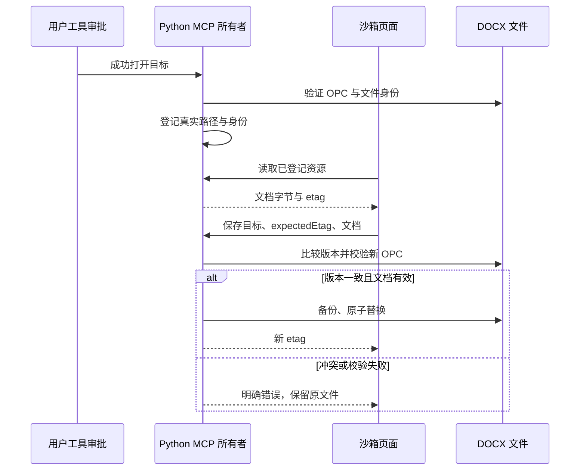

# 插件：office-editor（界面内操作 Word）

| 字段       | 内容                                                                               |
| ---------- | ---------------------------------------------------------------------------------- |
| 变更       | 新增一个**插件形态**的 Office（首期 DOCX）能力：界内修订审阅与编辑入口，核心零分叉 |
| 用户入口   | 文件树 / 预览面板的 Word 文件 → 工具调用 `open_editor` → 侧栏/inline 插件页面      |
| 执行所有者 | 插件侧 stdio MCP server（本机 Python 标准库）；页面在宿主沙箱 webview 内           |
| 范围外     | 完整 WYSIWYG 编辑器（P0.1 才引入 SuperDoc/canvas-editor）；云端执行；跨端同步      |

## 背景与判断

调研（2026-10-12）表明，腾讯 WorkBuddy 与 360 纳米Work 宣传的「在页面里直接操作 Word」实现方式是 **agent 在授权目录/云电脑里读写真实文件 + 文件面板 + 自然语言迭代**，而不是内嵌 Word 编辑器：纳米Work web 端的前端指纹里只有 `pdfjs`/`katex`/`highlight.js`，没有任何 Office 渲染或编辑库；WorkBuddy 官方口径是「用户在授权目录范围内可直接读取与写入文件，成果直接保存至本地」。

因此本项目不做「核心集成一个编辑器」，而是：

1. **能力放进插件**（`skills` + `mcp` + 插件页面），随公司市场（AIHub）独立发版；
2. **核心只留通用 seam**（见下「P1 契约」），保证上游将来自己做原生 Office 编辑器时，我们既可以对齐、也可以整体停用/卸载；
3. 上游 v3.15.1 合并的教训：核心分叉越少，未来合并越便宜。

## 产品规则

### 合并前数据与资源边界修复（2026-10-21）

- 文档文件仍由 Python 插件工具唯一写入；沙箱资源读取不经过工具审批，因此只允许读取本进程中已经成功执行过工具的目标。登记真实路径与文件身份，扩展名不构成授权，路径换向或文件被外部替换后必须重新通过工具打开。
- 资源授权检查与读取必须绑定同一文件描述符：对已批准 realpath 使用 `O_NOFOLLOW`（平台支持时）打开，随后 `fstat` 比对登记的 dev/ino；meta、分块、修订标记与段落解析都沿用该描述符，不再按路径二次打开。读取前后核对 fd 的 etag 与路径身份；页面后续块携带首次 meta 的 etag，任何换向、原地内容变化或版本不符都拒绝并要求重新打开/重载。
- 所有 DOCX 入口在解压前检查成员数量、单部件与累计展开大小，拒绝重复或越界成员名。页面与服务端整份写回的 base64 上限统一为 8 MiB（6 MiB 文档），发送前即拒绝超限，给 10 MiB stdio 帧保留封装余量；暂不支持分块写回。写回前验证 OPC 内容类型、根关系、正文根节点与完整 ZIP 校验；验证失败不创建备份、不修改原文件。
- 修订处理与格式修改保留原 XML 的命名空间声明，尤其是 `mc:Ignorable` 等属性值引用的前缀。段落文本工具只支持纯文本 run；遇到已有修订、超链接、域、图像或锚点等复杂内容，返回错误并保留原文件。直改的公共前缀不得重复，关闭格式需显式覆盖继承样式。
- 页面状态、预览、编辑器、宿主启动按四个脚本分段，并按顺序内联到同一模块；只有 `page.js` 的 state 是状态所有者。SuperDoc 的 `unsafeEval` 只在 HTML 资源项 `_meta["zcode/csp"]` 声明，遵守宿主资源级权限契约。
- 整份保存必须带 `expectedEtag`（加载时取得的版本）；文件已变化则拒绝写入。页面的编辑实例绑定路径与加载版本，换目标即销毁旧实例；异步旧加载与旧导出不得写入新目标。保存成功更新实例版本，卡片处理修订后旧编辑器保存应产生冲突，要求显式重载。
- 验收：纯文本共享前缀直改准确；复杂段落拒绝且字节不变；接受修订后 MCE 前缀仍有效；畸形 OPC、ZIP 展开越限与版本冲突均拒绝且原文件不变；未打开文件与跨目标软链资源不可读；全部新增场景通过标准库回归，并保留原 MCP 冒烟及官方 SDK 断言。

- **插件的形态**：插件清单声明 `mcpServers.office`（`type: "stdio"`，`command` 由宿主注入 `${UWORK_PLUGIN_ROOT}`）；服务器名由宿主命名空间化为 `plugin:office-editor:office`。
- **工具即授权边界**：写入通过工具调用发生（复用 Agent 的审批与审计路径）；页面只经宿主桥访问工具与资源，没有文件系统原语。成功工具调用登记目标后，页面可免重复工具审批读取该文件的资源；资源读取不得扩大已授权的文件范围。首期不做自动保存，只有显式的「接受/拒绝/另存」动作。
- **文档=不可信内容**：本插件不解包渲染第三方 HTML 进主渲染进程；页面在沙箱 webview 内运行，且不把文档内容当指令执行（沿用 `docs/ui/office-file-preview.md` 的既有边界）。
- **写入必须可回滚**：任何原地修改前先写 `<stem>_backup.docx`（已存在则 `_backup-2`…），并用「临时文件 + `os.replace`」原子替换。
- **审阅必须给位置与上下文**（2026-10-13 真机评审反馈）：只列"改了什么"不够——审阅者不知道改动在文档哪儿、周围是什么，就无法判断该不该接受。因此每条修订必须带：段落序号、表格坐标（若在表格内）、**最近标题**、以及**变更前后文**（把被删除的文字也放进上下文）；页面按"位置 → 上下文（变更高亮）→ 元信息"呈现。
- **首期只做 DOCX 修订（revisions）**：列出/接受/拒绝 `w:ins`、`w:del`；批注（`w:comment`）只读列出。XLSX/PPTX 不在本期。
- **诚实标注未实现**：`export_pdf` 明确返回「未实现（需 LibreOffice）」而不是假装成功。

## 大文档与大量标注（2026-10-14 压测与实现）

**问题**：宿主的工具结果有字节上限（`content` 32 KiB / `structuredContent` 64 KiB）。实测一份
1600 条修订 + 300 条批注的文档，**一次性返回体 1061 KiB**（33 倍于上限）——不分页必然被截断，
页面会拿到不可用的数据。这是"很多标注"场景的硬约束，不是体验优化。

**实现**：`docx_revisions_list` / `docx_comments_list` 分页（`offset`/`limit`，默认 25/页、
**服务端上限 40/页**、`kind` 可只看插入或删除）；总数与分布（插入/删除/批注）始终全量返回。
服务端按 `(绝对路径, size, mtime_ns)` 缓存解析结果，翻页/刷新不重解析；写回后清缓存。

**实测（3.9 MB `document.xml`、6000 条修订、800 条批注、20 个表格）**

| 动作                        | 耗时                                 | 备注                 |
| --------------------------- | ------------------------------------ | -------------------- |
| 首次解析 + 首页             | 73 ms                                | XML 解析占大头       |
| 跳到第 5001 条（缓存命中）  | 0.2 ms                               | 翻页与页码无关       |
| 接受 10 条（含写回 + 备份） | 189 ms                               | 写回整份 3.9 MB 部件 |
| 页体大小                    | 15.9 KiB（25 条）/ 25.4 KiB（40 条） | 均在 28 KiB 安全线内 |

## P1 契约（核心 seam，本期只定义、不实现）

这三条是唯一需要动核心的部分，均设计为**通用**（不点名 Office），以便上游对齐或直接复用：

1. `PreviewPane` 的**文件视图 provider 注册点**：插件按扩展名/MIME 声明「我能提供某文件的内联视图」；命中时宿主用插件页面替代内建只读预览，失败/禁用时回退内建预览。
2. **打开方式（open-with）注册点**：文件树/预览面板出现「用 <插件> 打开」入口，把 workspace 文件路径作为工具参数交给插件。
3. （可选，最后评估）**受控文件句柄原语**：capability-gated 的 workspace 二进制读写句柄（含授权范围与审计），用于消除「每次保存一次 agent 往返」的开销。首期不做。

## 基线依赖（页面的可用前置，2026-10-14 确认）

**页面不是"装了就能画出来"——它还需要宿主那条线合进来。** 宿主页面体系（`packages/ui/src/plugin-ui/`、
`packages/shared/src/mcp-apps/`、沙箱 `pluginSandbox` preload）是**上游 v3.15.1 才带进来的**；`uwork`（3.16.0）基线上
这些源码不存在，`_meta.ui` 无处可渲染，宿主按契约回退成普通工具卡——基线分支上冷启动实测：主文档 DOM 里**没有**
iframe/webview/沙箱目标，日志里也没有 `plugin-ui-bridge` 行（是"无事发生"，不是报错）。

因此本插件的交付顺序与验收口径：

- **基线分支（`uwork`）**：MCP 工具可用（列修订/处理修订/导出）。页面**不会**出现，属预期；不要当成插件缺陷排查。
- **上游合并线（`chore/upstream-v3.15.1-sync`）**：页面才真正挂载——本 spec 的页面类验收全部在这条线上取得。
- **安装形态随宿主而变**：3.15.1 宿主只认 `.zcode-plugin/` + `${ZCODE_PLUGIN_ROOT}`；仓库内的 `.uwork-plugin/`
  - `${UWORK_PLUGIN_ROOT}` 需要带 UWork 别名的新宿主（`UWORK_MANIFEST_PATH`/`UWORK_*` env）。本地实测走
    `~/.uwork/cli/plugins/marketplaces/uwork-local-dev/office-editor/`（**拷贝**，非软链），改完插件要重新拷 + **冷启动**。
- **页面挂载期的瞬态**：冷启动恢复任务时，卡片会在会话的 MCP app 连接登记前就 prepare，宿主回 `-32001`；
  该窗口由宿主侧修复（`specs/plugin-ui-session-warmup-resilience.md`，有界退避自动重试），插件侧无需处理。

## 二期：预览与编辑

「保留一键审查，把预览与编辑做彻底」的调研结论、架构决策与分期见
[`specs/office-editor-editing-preview-research.md`](./office-editor-editing-preview-research.md)（2026-10-15）。要点：
页面按 4 MiB 分块读 `office://` 资源取字节（真实天花板是 MCP stdio 帧 10 MiB，不是 8 MiB）；
渲染用 docx-preview（Apache-2.0，`renderChanges:true`）+ 我们引擎的 id/作者/位置做浮层；
宿主内置预览 `renderChanges:false` 会**吞掉删除文字**，这是我们已有的差异优势；
「打开方式」接缝（P1 前两条）为 M 级核心改动，待拍板。

### 承载位置（产品规则，2026-10-15 定 / 同日修正）

**对话卡片只做「接受 / 拒绝」；侧边大窗口是一个类似 Office 的编辑页面——直接改文档，不做批准动作。**

- **对话卡片 = 审阅位，动作只有两个**：接受、拒绝（逐条 + 全部接受/全部拒绝）。卡片保留判断所必需的信息（位置、上下文、作者/时间、总数/翻页）与一个通往编辑页的入口（「在侧栏编辑」），**不放编辑能力、不放批注面板**。
- **侧边大窗口 = 编辑位，由成熟引擎承载**：**SuperDoc**（浏览器内 DOCX 编辑器，UMD 单文件 `superdoc.min.js` 1.3 MB + CSS 103 KB，随页面内联；页面合计 2 MB）。产品口径是**功能完善 + 相对轻量化**——所以不选需要几百 MB 服务端的 ONLYOFFICE/Collabora，也不自研（自研段落编辑已按用户裁定移除："太简陋"）。
  - 挂载：`new SuperDoc({ selector: "#superdoc-host", document: File, modules: { trackChanges: true } })`；文档字节走我们既有的分块资源读，整理成 `File` 交给它。
  - 它自带完整编辑 UI（工具栏/评论/修订视图），比我们自研的"段落级编辑"完善得多。
  - **许可闸门（需公司决策）**：SuperDoc 是 **AGPL-3.0**（商业许可见 superdoc.dev）。内部/评估可用；作为商业产品分发需购买商业许可，或改选自托管的 ONLYOFFICE（AGPL，几百 MB）/ Collabora（MPL-2.0，同样重）。
  - CSP：SuperDoc 包内有一处 `new Function`，HTML 资源内容项已声明 `_meta["zcode/csp"] = {"unsafeEval": true}`（不声明则沙箱内直接抛错）。
  - **引擎必须从真实 http(s) 地址加载（2026-10-15 实测结论）**：CDN 单文件只是加载器，运行时 `import("https://cdn.jsdelivr.net/npm/@superdoc/docx-engine@0.22.0/dist-cdn/docx-engine.es.js")`；引擎自身还会 `new Worker(new URL("./assets/browser-worker-entry-*.js", import.meta.url))`，壳对引擎地址做 http(s) 白名单并硬拼路径——**离线自包含＝同时维护两份被改过的压缩 vendor**（不采纳）。
    因此引擎地址做成**配置**：`engine.json` 的 `baseUrl`（内网静态镜像，需镜像 `@superdoc/docx-engine@0.22.0/dist-cdn/` 整个目录含 `assets/*worker*` 与 `style.css`）。配置后：工具描述自动把该域名加进 `connectDomains`/`resourceDomains`，页面经 `office://superdoc/config` 读取并设置 `globalThis.SUPERDOC_ENGINE_CDN_BASE_URL`（客户端不背 13 MB，页面仍 ~2 MB，引擎首次进编辑页拉取一次）。
    **留空 baseUrl** 时编辑器不可用——侧栏**回落只读预览**并显示原因（绝不留白屏）。
- 写回一律经插件工具（页面没有文件系统原语）：编辑器保存走 `docx_write_back(path, base64, expectedEtag)`——校验 zip/`document.xml`（宁可不写，也不把坏文件盖到用户文档上）→ 备份 → 原子替换 → 回读计数。真正的**修订标记**来自编辑器自身（`modules.trackChanges`），Word 打开仍是未接受的修订，回到对话卡片用我们引擎逐条接受/拒绝。

## 插件命名契约（UWork 命名 + 既有生态兼容）

### 服务侧插件清单接线（2026-10-21）

`SkillsService` 的插件技能列表与 Agent 加载器遵循同一清单发现顺序：共享常量 `UWORK_PLUGIN_MANIFEST_DIR` 指定的 `.uwork-plugin/plugin.json` 优先，然后回退 `.zcode-plugin`、`.claude-plugin`、`.codex-plugin`。列表仍从既有 CLI 配置与插件安装记录读取启停与根目录，不增加清单或启停状态所有者。

同一顺序适用于 CommandsService 的插件命令、SubagentsService 的插件代理、自有插件同步的候选/归档导入，以及 SettingsSyncService 的外部插件发现/显式导入。每个消费者只读取所选清单中的对应声明；新旧清单并存时不合并组件。显式导入仍遵循原目标作用域：项目 `.zcode/plugins` 与项目配置路径保持原约定，用户级 UWork 根不改为上游目录；不触碰 OAuth 或账号恢复。

验收走真实 `SkillsService.list`：只含 `.uwork-plugin` 的插件可以列出声明技能；新旧清单同时存在时只使用 UWork 清单；三个历史清单目录各自仍能独立贡献技能。用户级插件缓存使用当前 UWork storage root，显式 `storage.dir` 继续保留。

其余四面分别运行实际命令列表、插件代理列表、候选→导出→远端归档导入、外部发现→项目复制导入；每面均覆盖 UWork 单清单、三种旧清单和新旧并存优先级，不能仅测试候选路径常量。

结论先说：插件交互面里 **`.zcode-plugin`、`ZCODE_PLUGIN_ROOT`、`@zcode/*` 都不是"忘了改品牌"**，而是宿主契约与上游内部命名——
`.zcode-plugin` 是加载器唯一认识的清单目录（`marketplace.ts` 的候选表），`ZCODE_*` 由宿主注入，`@zcode/*` 是包作用域
（全仓 2179 个文件）。**用户可见的部分早已是 UWork**（数据根 `~/.uwork`、插件缓存 `~/.uwork/cli/plugins/cache/…`、
`zcode → UWork` 的显示名映射、i18n 基本清零）。

因此本期给"我们自己的东西"加了一层 **UWork 命名别名**，同时保持既有生态可加载：

| 面       | UWork（首选）                                                                       | 兼容（继续支持）                                     |
| -------- | ----------------------------------------------------------------------------------- | ---------------------------------------------------- |
| 清单目录 | `.uwork-plugin/plugin.json`                                                         | `.zcode-plugin` / `.claude-plugin` / `.codex-plugin` |
| 占位符   | `${UWORK_PLUGIN_ROOT}` / `${UWORK_PLUGIN_DATA}` / `${UWORK_PROJECT_DIR}`            | `${ZCODE_*}` / `${CLAUDE_*}`                         |
| 注入 env | `UWORK_PLUGIN_ROOT` / `UWORK_PLUGIN_ID` / `UWORK_PLUGIN_DATA` / `UWORK_PROJECT_DIR` | `ZCODE_*` / `CLAUDE_*`（同时注入）                   |
| 新建插件 | SkillHub 包装产物落在 `.uwork-plugin/`                                              | 历史安装的 `.zcode-plugin/` 目录照旧可读             |

发现顺序为 UWork 优先、随后回退；两者同时存在时取 `.uwork-plugin`。**本插件自身即采用 UWork 命名**（`.uwork-plugin/plugin.json` + `${UWORK_PLUGIN_ROOT}`），
所以它同时是这层契约的第一个消费者与回归样本（`test/pluginUworkAliases.test.ts`、`test/officeEditorPlugin.test.ts`）。

**将来重构自研底座时要改哪些**：只需处理这张表里的"面"（外加包作用域 `@zcode/*` 与目录 `apps/zcode-cli` 这类内部标识），
不需要碰插件生态——因为别名层已经让两侧同时可用；反过来若现在就全量改名（2179+ 文件），每次上游合并都要重新做一遍，
v3.15.1 合并的 100 个冲突就是代价样本。

## 验收

- `docx_revisions_list`：在带 1 个 `w:ins`、1 个 `w:del` 的样本上返回 2 条修订，字段含 id/kind/author/date/text，以及位置与上下文：`paragraph`（段落序号）、`table`（`{index,row,cell,rows,cells}` 或 null）、`nearestHeading`（`{text,level}` 或 null）、`context`（`{before,after}`，变更前/后文，删除的文字也在内）、`paragraphText`。
- `docx_revisions_resolve(accept)`：接受后 `w:ins` 解包（文字保留）、`w:del` 整体删除；再次列出为 0；原文件已被 `_backup.docx` 备份；zip 其余部件逐字节保留。
- `docx_revisions_resolve(reject)`：拒绝后插入文字消失、删除文字恢复为正文。
- 协议面：`initialize` / `tools/list` / `tools/call` / `resources/list` / `resources/read` 冒烟通过；`resources/read` 返回的 HTML < MCP 页面上限（16 MiB），mimeType 为 `text/html;profile=mcp-app`。
- **未验证（需人工）**：应用内页面渲染、在页面里点「接受/拒绝」、侧栏承载与回收。桌面 E2E 需要人工在 Chrome 里授权远程调试，无人值守跑不了（见仓库既有约束）。

## 本次验证记录（2026-10-12）

**已执行**

- 插件自检 `python3 plugins/office-editor/verify/mcp_smoke.py` → **20 项断言全过**（协议握手、4 个工具、列出样本 1 插入 + 1 删除、接受后插入文字保留且 `w:ins` 解包、备份存在、**无关 zip 部件逐字节一致**、拒绝后 `w:delText` 还原为 `w:t`、修订清空、`docx_export_pdf` 正确 `isError`、页面 417 KiB / mime `text/html;profile=mcp-app`）。
- **宿主真实加载链路**（`apps/zcode-cli/packages/adapters/test/officeEditorPlugin.test.ts`，`tsx --test`）：`validateLocalPluginPath` 0 error；`resolvePluginMcpServers` 解析出 `plugin:office-editor:office`，命令 `python3 <plugin>/server/server.py`，注入 `UWORK_PLUGIN_ROOT`/`UWORK_PLUGIN_ID`（并保留 `ZCODE_*`）。
- **官方 MCP SDK 客户端**（同一测试内）：连接 stdio、列出 4 个工具、`docx_revisions_list` 得到 1 插入 + 1 删除、`docx_open_editor` 返回 `_meta.ui.resourceUri`、`resources/read` 取回页面（>1000 字符）。
- **页面在浏览器里真渲染**：把装配后的 426,699 字节页面经本地 HTTP 打开 —— 标题/工具条正常、418 KiB 的 ext-apps bundle 无语法问题；无宿主时按设计回退。**由此发现并修掉一个问题**：原先只在 `typeof App === "undefined"` 时提示，而 bundle 已定义 `App`，于是 `connect()` 悬挂会让页面只剩灰按钮——现在加了 5 秒握手超时与失败提示（实测回退提示可见）。
- **UWork 命名别名**（`test/pluginUworkAliases.test.ts`）：`.uwork-plugin` 单独存在可被发现、旧 `.zcode-plugin` 仍可加载、两者并存时取 `.uwork-plugin`、`${UWORK_PLUGIN_ROOT}` 与 `${ZCODE_PLUGIN_ROOT}` 都能展开、四种 env 同时注入。
- `oxfmt --check` / `oxlint` 于新增与改动文件干净；`pnpm lint` 111 warnings / 0 errors（该基线原有 111/0）；`pnpm typecheck` 0 error，`adapters`、`bootstrap` 两个包各自的 `tsc --noEmit` 0 error。
- CI 增加一步：`Validate office-editor plugin and UWork plugin naming aliases`（`tsx --test` 跑上面两个测试文件）。

### 真机验收（2026-10-13，dev 客户端 + 真实模型 + 真实沙箱页面）

- **页面真的能挂载**：`docx_open_editor` 的工具描述带 `_meta.ui.resourceUri` 后，宿主创建了
  `ZCode Plugin Sandbox` webview + `zcode-sandbox://plugin-…` iframe，页面在对话内联卡片里渲染。
- **页面能自举拿到目标文件**：页面显示的是真实的 `/tmp/oe-test/sample.docx`（经由 `ontoolinput` 或
  兜底工具 `docx_current_target`），不再停在"等待宿主传入文件"。
- **列表与位置/上下文全部正确**：实测两条修订分别渲染为「插入/删除 + 接受/拒绝 + 第 2 段 ·
  「一、概述」+ 上下文（插入文字绿下划线、删除文字红删除线，被删文字也出现在上下文里）+ 作者/时间/id」。
- 两个**平台行为**（真机才发现，文档未写）：
  1. 页面引用**只从 `tools/list` 的工具描述 `_meta` 读**（`apps/zcode-cli/packages/adapters/src/mcp/descriptor.ts`），
     写在调用结果上不会被识别——表现就是"页面不出现、回退成普通工具卡"。
  2. 插件版本与页面资源**按会话/宿主进程绑定**：装完新版本必须**冷启动客户端**才生效
     （用户指出并实测确认），热装只改 cache 目录不会改变已运行的会话。
- 体验观察（待定）：页面自己发起的工具调用（列修订/处理修订）**每次都走一次权限确认**，
  对"点一下接受/拒绝"的交互偏重；评估"始终允许本项目"或按会话授权是否合适。

**未执行（需人工）**

- 在客户端里真正承载页面（侧栏/inline）、点接受/拒绝、公司市场安装链路与 AIHub 分发。桌面 E2E 需人工在 Chrome 里授权远程调试。
