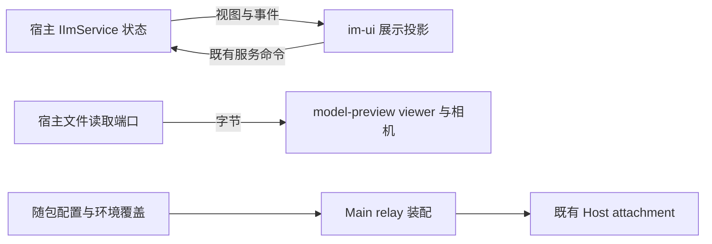

# PR #10 / #11 模块准入

## 目的

合并 IM、3D 预览和自建 relay 时，新增源码必须通过相对 `uwork` 的增量架构门禁。
本次仅登记现有实现的边界、公开入口和契约，不改变产品行为或扩大 legacy 豁免。

| 模块                       | 所有者与源码范围                                                                         | 公开接口                                                                     |
| -------------------------- | ---------------------------------------------------------------------------------------- | ---------------------------------------------------------------------------- |
| `im-ui`                    | `packages/ui/src/im`；消息状态仍由宿主 `IImService` 所有，UI 只持有展示与编辑状态        | 消息面板、未读投影 hook、通知 hook；通过既有 workspace service hook 访问服务 |
| `model-preview`            | viewer、格式识别、labels hook、懒加载入口；viewer 持有解析结果与相机，文件读取由宿主注入 | viewer props/labels、格式识别、懒加载预览入口、labels hook                   |
| `desktop-web-remote-relay` | 原有 Main relay 模块额外覆盖随包入口配置解析文件                                         | 原有 relay 接口，以及现有配置读取、解析、覆盖优先级接口                      |

- `im-service` 登记既有宿主视图、缓存和补洞编排；同一 RPC 契约按会话、时间线、消息附加操作和汇报四组能力组织，事件与视图单独定义，方法名、参数及通道不变。
- `im-protocol` 登记 shared 的既有 `im.ts` / `imCard.ts`，聚合入口不复制 schema 或解析器。
- `desktop-im` 登记 Main 既有的角标写入点与附件适配，任务/消息计数仍在 appBadge 汇合，附件异步写入且同名不覆盖。

两类 UI 模块依赖现有 UI 基础设施；IM 另依赖 shared/services 的公开类型与服务接口。
新模块不拥有会话、任务队列或持久化真相，也不改变 Desktop continuous 与手机 replayable 的交付边界。

## 验收

- 新模块提供 module、contract、example、contract test 与 CONTRACT.md，公开接口与策略一致。
- IM 面板重复打开保持同一 workspace tab，切换任务仍可见；不同 workspace 保持隔离。
- 模型格式识别和注入读取端口保持不变；普通预览不提前加载 three。
- Main 配置仍按环境覆盖、随包配置、内置默认的顺序装配，不新增状态所有者。
- 同时保留 PR #10 的 IM 与 PR #11 的 3D 侧栏回归测试。
- 相对 `origin/uwork` 的增量架构检查、typecheck、lint 和相关回归通过，再合并。
