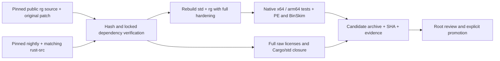

# Public Windows ripgrep compatibility build

The candidate keeps ripgrep 14.1.1 at upstream commit 4649aa9700 and the original Microsoft BinSkim patch from producer 7ea8b7eb6c0de96fe4275bba5e88cb49297af42e. A fixed public nightly-2025-06-26 compiler, matching rust-src and source hashes replace the private ms-1.88 toolchain. Every Rust crate, including std and panic runtime, is rebuilt with `-Zbuild-std`; RUSTC_BOOTSTRAP is forbidden. The only patch adaptation removes the private Cargo registry redirect while preserving hardening and locked crate checksums.

The producer owns source verification, isolated cargo/rustup homes, build flags and executable/archive fingerprints. The material collector owns complete raw distribution copyright files and the target Cargo/std closure, without substituting another Rust revision. Native Windows x64 and arm64 jobs execute upstream tests, compatibility tests, PE/CFG/CET/static-runtime checks and BinSkim. A success requires native execution on each architecture; inspecting a PE on macOS is not a Windows pass.

Required behavior remains CLI flags, PCRE2 10.43, JSON events, UTF-8 file names/content, ignore/glob rules, stdin and exit codes 0/1/2. Original Windows hardening includes CFG enforcement (not nochecks), static CRT, Spectre-mitigated MSVC libraries/C compilation, ASLR/NX and x64 CET. Public precompiled std alone is insufficient evidence; build output must prove std was recompiled under the same flags. Missing hardening/materials or a toolchain mismatch fails the candidate rather than relaxing a check.

The workflow only runs manually or on the isolated `codex/pr4-ripgrep-verify` branch. It uploads candidate evidence and does not publish a release or change PR4. Existing release registrations and the private Rust review obligation remain until both real candidates pass and are explicitly promoted with their exact archive/executable hashes and complete material binding.

Acceptance: dependency-free Node contracts first reproduce missing plan/integrity/hardening behavior, then pass locally. Source preparation may run on macOS to verify original archive/patch bytes. Compilation, std instrumentation, BinSkim and executable compatibility are only accepted from the native Windows jobs. Failure artifacts retain source/lock/metadata/compiler identity and logs for repair.

Source audit: upstream `[profile.release]` uses debug=1 and the default unwind strategy; panic=abort belongs only to `[profile.release-lto]`, which the original Microsoft Windows command does not select. Both candidate and upstream tests rebuild `std,panic_unwind` and retain the original release profile. The producer records the actual fresh panic_unwind/std artifacts and verbose std compiler command. The exact rustc component itself carries the two generated copyright HTML files and 12 license files; the collector binds that actual dated layout and matching source notices, without adding rust-docs.

The final independent seal recomputes executable/PDB/archive and all material hashes, validates native compatibility and full BinSkim reports, and requires no unproved runtime scope before writing `verified-candidate.json`. The producer manifest is kept immutable so the collector binding remains valid. The MSVC setup prepends the actual target Spectre directory to LIB; the producer records required static library hashes, toolchain version and search order.

The native jobs select the available v143 MSVC 14.44 toolset on both runner architectures, record the actual Visual Studio installation version (including the ARM runner host IDE), and hash the selected target Spectre libraries. Toolset selection does not imply the original runtime terms are complete; the material/seal gates separately require their verified original text and applicability.

Security acceptance: the PCRE2 10.43 baseline is affected by [GHSA-r9hj-j2rw-4q3m](https://github.com/PCRE2Project/pcre2/security/advisories/GHSA-r9hj-j2rw-4q3m). Ripgrep enables JIT on 64-bit targets and configures a growable 10 MiB JIT stack, so this is a reachable engine path on the existing x64 and arm64 targets. The first Windows builds retain that baseline only for toolchain, hardening, native compatibility and licensing evidence. Their producer records `baseline-unpatched` and `not-run`; the independent seal must reject that state even when CRT materials and all other reports are complete. Promotion additionally requires the exact official fix adapted to the pinned source and a real failing-before/passing-after native PoC regression bound to each candidate executable. The repair covers all six existing rg targets, preserves PCRE2/JIT, ripgrep 14.1.1 and current flags, and does not include unrelated 32-bit or unused serialization advisories.
