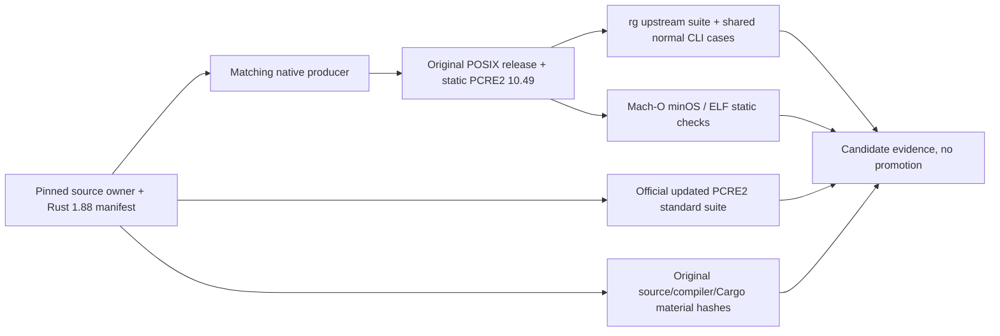

# Public POSIX ripgrep compatibility candidates

## Objective and fixed compatibility boundary

Build reviewable PCRE2 10.49 candidates for all four existing POSIX rg targets,
using the shared pinned source preparation and ordinary CLI cases. Keep rg
14.1.1/revision 4649aa9700, public Rust 1.88.0/commit
6b00bc3880198600130e1cf62b8f8a93494488cc, original precompiled standard library,
release/unwind semantics, PCRE2 static linking and target JIT availability.
The four existing archives contain this public compiler source revision; the
same revision's raw Rust source notices are already in third-party material.

| Target                     | Native runner    | Runtime boundary                                 | rg JIT   |
| -------------------------- | ---------------- | ------------------------------------------------ | -------- |
| aarch64-apple-darwin       | macos-15         | macOS deployment target 12.0, system dylibs only | disabled |
| x86_64-apple-darwin        | macos-15-intel   | macOS deployment target 12.0, system dylibs only | enabled  |
| aarch64-unknown-linux-musl | ubuntu-24.04-arm | musl static, no interpreter/NEEDED/glibc         | disabled |
| x86_64-unknown-linux-musl  | ubuntu-24.04     | musl static, no interpreter/NEEDED/glibc         | enabled  |

Runner labels are documented by [GitHub](https://docs.github.com/en/actions/reference/runners/github-hosted-runners).
Native platform/architecture must match; a cross build, emulation, or static
inspection cannot claim native execution.

The pinned Microsoft producer's POSIX install.sh configures `debug=0`,
`strip=true`, `lto=true`, `codegen-units=1`; retain those release overrides and
default unwind. Linux arm64 retains `JEMALLOC_SYS_WITH_LG_PAGE=16` and native
musl-gcc/lld. Do not add Windows CFG/std rebuild flags to POSIX or weaken JIT
checks on the x64 targets.

## Ownership and evidence

The existing source preparation owner verifies the rg/Microsoft/PCRE2/crate
archives and prepares the same pcre2-sys path crate. It accepts an optional
pinned Rust manifest argument so POSIX records its own compiler's manifest.
`scripts/public-posix-ripgrep-plan.mjs` owns target/compiler/profile contracts;
`scripts/build-public-posix-ripgrep.mjs` owns isolated compilation and evidence.
`scripts/public-ripgrep-compatibility.mjs` remains the single owner of 11 normal
CLI cases shared with Windows.

Use the official 2025-06-26 Rust 1.88.0 manifest, SHA-256
431b7c5c0b9a511d8e31d29b378bbc74124e8521f14beb92d3a5a5f7e7e55449.
Download/extract its pinned rustc/cargo/host std/target std/rust-src components
into the fresh work directory and install them into an isolated prefix. Check
the actual rustc release/commit/host and component hashes; do not select a newer
compiler or rebuild std. Record actual native C compiler/linker versions, target
runtime package notices where applicable, actual executable hash and archive.
Retain the verified original component archives under `artifacts/rust-components`
and the original rg archive in artifacts. Bind every installed compiler/cargo/std
bin/lib file to its original component payload byte for byte; exclude unused
rust-src from this compiled-runtime inventory. Save the prepared root manifest
and pure-JSON Cargo metadata separately from download progress on stderr.

Retain compiler distribution original COPYRIGHT HTML and all linked license
texts, matching Rust source notices, and original checksum-bound Cargo crate
notices selected by normal/build target-filtered resolve graph. PCRE2 notices
come from the prepared path crate, retaining raw 10.49/sljit originals. Record
the complete raw files and hashes without changing the existing Windows
collector or CRT policy. Any incomplete material scope remains explicitly
unsealed; source metadata or three top-level Rust notices alone do not establish
complete redistribution acceptance.



## Verification and failure rules

Tests in `scripts/test/public-posix-ripgrep.test.mjs` cover native admission,
exact compiler identity, fixed source/profile/JIT/minOS/static requirements and
manifest component selection. Producer runs `cargo metadata --locked` and
`cargo build/test --release --locked --all --features pcre2 --target <target>`
with isolated cache/output. Original locks must not drift. All four targets run
upstream tests rather than skipping ARM tests. PCRE2 official 10.49 tests build
8/16/32 libraries and JIT; this library-suite capability is distinct from the
unchanged disabled rg JIT on the two ARM targets.
Linux runs that standard suite with native musl-gcc and static linking too.

```sh
node --test scripts/test/public-posix-ripgrep.test.mjs scripts/test/ripgrep-pcre2-source.test.mjs
node scripts/build-public-posix-ripgrep.mjs --platform=darwin --arch=arm64
pnpm typecheck
pnpm lint
pnpm architecture:check --changed
```

The independent workflow runs only manually or on
`codex/pr4-ripgrep-verify`, preserves success/failure evidence, and publishes no
release. It runs `verify-public-posix-ripgrep-candidate.mjs` on the same native
runner after the producer: independently rebuild the pinned source inventory,
recheck original components/materials/logs and archive bytes, inspect the actual
binary, and rerun the shared normal CLI cases. Producer completion alone is not
an accepted candidate. Existing runtime registrations/archives, Windows policies and legacy
rg13 assets remain unchanged. No independent exploit/PoC or old-version
vulnerability trigger is generated, downloaded, analyzed or executed. Security
sealing remains fail closed until all required ordinary upstream/native,
compatibility, platform and original-material evidence is complete.
