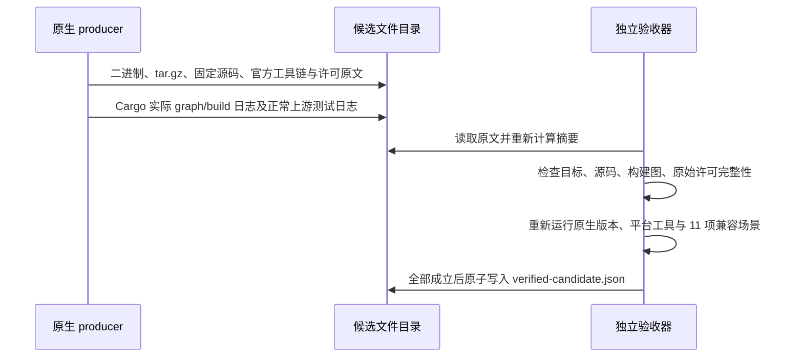

# POSIX ripgrep candidate 的独立验收

## 规则与所有者

`build-public-posix-ripgrep.mjs` 只生产待审查候选；
`verify-public-posix-ripgrep-candidate.mjs` 是验收记录的唯一写入者。
验收必须在候选对应的原生 macOS/Linux、x64/arm64 runner 上执行。产物目录中的
`status`、`passed` 和摘要只用于关联证据，不是独立的通过依据。

本任务只更新官方 PCRE2 10.49 并执行正常上游回归，不运行独立漏洞 PoC，也不对
旧版本触发漏洞。最终记录明确保留 `independentPoc: not-run`，不得改写为已通过。
验收记录不发布资产、不修改主分发登记、不表示 PR 已具备合并条件。

## 接口与事件顺序

CLI：`node scripts/verify-public-posix-ripgrep-candidate.mjs --output-dir=<artifact-dir>`。
模块导出纯验收函数供合同测试使用；文件验收函数不得允许调用者覆盖当前原生
platform/arch。成功记录包含目标、实际 runner、工作流上下文、所有已核验文件摘要
及真实安全验收边界。任何失败不产生成功 seal，已存在的旧 seal 在开始验收时删除。

## 验收场景

- tar.gz 必须与候选实际 `rg` 的确定性单成员归档完全一致，拒绝摘要、权限、成员或
  二进制漂移；实际 ELF/Mach-O 架构与原生 runner 一致。
- macOS 最低版本保持 12.0，动态依赖仅允许原有系统库；Linux musl 无解释器、
  无动态依赖、无 GLIBC 版本要求。平台工具在验收时重新读取实际二进制。
- Rust 1.88.0 精确 public revision、固定官方发布 manifest、实际安装 compiler、
  Cargo、std 组件与官方原始组件归档对应。源码、Microsoft 补丁、PCRE2 release
  与 crate 的实际文件摘要必须等于固定值。
- 独立离线 Cargo 元数据复算使用刚核验的绝对 Cargo/Rustc 路径及同一临时 cargo-home，
  PATH 优先放入该工具链，并移除继承的 Rustc wrapper。不能让 runner 默认 Rust
  或用户 wrapper 成为另一条编译器选择路径。
- 从固定源码和原始补丁重新准备 PCRE2 crate，逐文件核对实际 build 输入，拒绝
  只保留自报 `preparedFiles` 的缩减清单。实际 Cargo.lock 和 Cargo 元数据必须匹配。
- 实际 Cargo graph 覆盖所有 compiler-artifact，存在 fresh=false 的目标 `rg`、
  `pcre2-sys` 和 PCRE2 build-script 证据，二进制与 compiler artifact 输出相同。
- 读取正常 ripgrep 上游测试和新版 PCRE2 standard suite 原始日志，要求有实际
  非零执行、零失败。固定 ripgrep 14.1.1 原始源码已有的
  `matcher::tests::candidate_lines` 因上游 inner literal extraction 未实现而标记忽略；
  只允许此精确名称最多一次，并在 seal 单独列出。禁止新增忽略、过滤测试或删除断言。
  PCRE2 的四项标准 suite 全部成功且零忽略。独立 PoC 仍未执行。
- 原生重新执行全部 11 项兼容场景，与固定旧版普通行为比较。拒绝少项、错退出码、
  错候选、错 baseline；JSON 只消除 elapsed 和不承诺的跨文件遍历顺序。
- Rust/compiler/std 与 Cargo graph 的所有许可文件从原始组件或 crate 重新核对；
  缺文件、路径越界、替换原文、减少 graph、许可输入摘要不一致均失败。Linux
  静态运行时材料匹配 runner 的实际包版本和原始 copyright/common-licenses。
- Ubuntu `common-licenses` 中 GPL/LGPL/GFDL 等指向同目录原文的符号链接也是必须
  保留的发布方文件名。验收比较完整别名清单与解析后的原文，不能因通用遍历器忽略
  symlink 而删减材料；所有解析路径须在实际许可目录内，越界或断链立即失败。
- 合同测试覆盖通过案例及错误架构、错误摘要、缩减测试/许可/graph、旧 PCRE2、
  未运行上游测试、测试失败和路径越界等反例；不得用 skip 或忽略失败获得通过。
