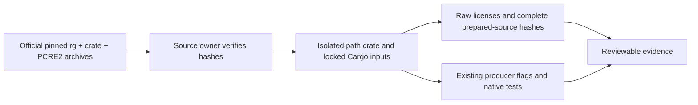

# ripgrep PCRE2 source maintenance

## Objective and boundary

Prepare a reviewable ripgrep 14.1.1 source candidate with the official PCRE2
10.49 release. Keep the original Microsoft hardening patch, release/unwind
profile, public Rust/std identity, static linking, Unicode and existing target
JIT policy. This source-only maintenance stage does not register or publish a
native release, modify the material collector/CRT bindings, or establish six
platform acceptance. No standalone exploit, PoC, old-version vulnerability
trigger, or memory-corruption verification is generated, downloaded or run.

The existing candidate seal remains fail closed. Its earlier exploit-regression
requirement is outside this authorized maintenance stage; this stage does not
invent a passing security result to satisfy it.

## Ownership, inputs and interface

`scripts/public-windows-ripgrep-source.mjs` owns isolated source preparation.
`preparePublicRipgrepSources(workDir, artifactsDir)` prepares the same pinned rg
archive and Microsoft patch, then calls a target-independent PCRE2 preparation
function. Only this owner writes the extracted Cargo inputs. The existing build
producer consumes its returned source/material fingerprints.

The returned `pcre2.releaseDir` points to the complete extracted official release
for standard post-update upstream suite execution. Its two evidence archive
records identify the original source bytes; this directory does not replace the
prepared path crate consumed by Cargo.

Inputs are fixed official archives, verified before extraction:

| Input           | Source                                                                                 | SHA-256                                                          |
| --------------- | -------------------------------------------------------------------------------------- | ---------------------------------------------------------------- |
| pcre2-sys 0.2.9 | https://static.crates.io/crates/pcre2-sys/pcre2-sys-0.2.9.crate                        | 550f5d18fb1b90c20b87e161852c10cde77858c3900c5059b5ad2a1449f11d8a |
| PCRE2 10.49     | https://github.com/PCRE2Project/pcre2/releases/download/pcre2-10.49/pcre2-10.49.tar.gz | 929f0b20e62879252a15886b06c89f1edef61a363cbd5826fb041080a5e557ae |

The crate digest must also match the original rg Cargo.lock entry. The PCRE2
digest is published by the [official release API](https://api.github.com/repos/PCRE2Project/pcre2/releases/tags/pcre2-10.49).
This SHA binding is not a claim that the release signature was verified.

## Preparation rules and failure semantics

1. Verify both archives and the original pcre2-sys lock identity/checksum.
2. Extract pcre2-sys into `source/vendor/pcre2-sys`; preserve its Rust bindings,
   build.rs and original Rust license files byte for byte.
3. Replace only its `upstream` tree using PCRE2 10.49's documented library C
   files, source headers, generic config/header, default character table and
   `deps/sljit/sljit_src` tree. Use the release's current relative sljit layout.
   Do not compile test/fuzz/CLI sources as library members.
4. Retain raw PCRE2 COPYING, LICENCE.md and sljit LICENSE at their original
   relative paths, and save those raw bytes plus both archives as evidence.
5. Add one Cargo `[patch.crates-io]` path override. Remove source/checksum only
   from that one pcre2-sys lock entry; retain all other locked entries exactly.
   Builds and metadata continue to use `--locked`; no network resolver update.
6. Record archive origins, before/after Cargo hashes, unchanged Rust/build.rs
   hashes, original license hashes and every prepared crate file hash in
   `pcre2-source-evidence.json`. Record the original lock as evidence as well.
7. Reject a changed/missing identity, existing patch section/vendor directory,
   missing documented input, unexpected version or incorrect digest. A failed
   preparation never produces a verified-candidate seal; use a fresh work dir.



## Commands and acceptance

Contract tests use dependency-free Node `node:test` in
`scripts/test/ripgrep-pcre2-source.test.mjs`. Test archive/lock identity rejection,
one-entry lock transformation, preservation of unrelated locks and compiler
capabilities, required library files, exact raw license retention, complete
prepared-file hashing and repeat invocation rejection before running a real
source preparation. Follow existing ESM/async-IO script style; for example
`await writeFile(path, JSON.stringify(evidence, null, 2) + "\n")`.

```sh
node --test scripts/test/ripgrep-pcre2-source.test.mjs scripts/test/public-windows-ripgrep.test.mjs scripts/test/windows-ripgrep-license-materials.test.mjs
node scripts/build-public-windows-ripgrep.mjs --arch=x64 --prepare-only --work-dir=.tmp/pcre2-maintenance/x64/work --output-dir=.tmp/pcre2-maintenance/x64/artifacts
pnpm typecheck
pnpm lint
pnpm architecture:check --changed
```

After preparation, permitted verification is normal search behavior, supported
PCRE2/JIT capability/version reporting, ripgrep's upstream suite and the official
PCRE2 10.49 standard suite. Only the updated engine is tested. Local C-suite
results and source preparation are distinct from a native Windows rg build.

The current producer supports native Windows x64/arm64 only. A full six-target
producer additionally needs explicit macOS arm64/x64 deployment-target checks,
Linux arm64/x64 musl static toolchains, native execution, immutable archives,
and source/material binding for each target. Existing platform JIT availability
must be preserved; the pcre2-sys build script currently excludes macOS arm64 and
Linux arm64 musl. No runtime registration changes occur until all required
target candidates are independently accepted.
