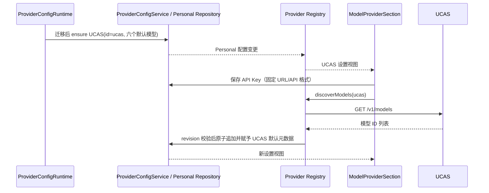

# UCAS 默认模型供应商

## 产品规则

- 首次启动时，模型设置默认出现唯一的 `ucas` 供应商；不配置默认 API Key。若旧配置已有 ID 为 `ucas` 或显示名为 `ucas` 的个人供应商，则迁移/合并到固定 ID `ucas` 和 UCAS 模板，固定名称/API 地址/API 格式，保留 API Key、已有模型参数和顺序，并补齐缺少的默认模型。
- UCAS Base URL 固定为 `https://llm.ucas.com.cn:15000/v1`，API 格式固定为 Chat Completions (`openai-chat-completions`)。名称、地址、格式和删除操作不可编辑；API Key、模型发现、模型启停与模型元数据仍可使用。
- 默认模型来自图片所示目录：`ucas-deepseek-flash`、`ucas-gpt-max`、`ucas-gpt-mini`、`ucas-kimi`、`ucas-glm`、`ucas-gemini-flash`。
- 默认模型及此后由 UCAS 自动发现的新模型均使用 1,000,000 上下文，启用文本和图片输入，推理等级为 low/high/max。重新获取不能覆盖已经存在的模型配置。
- “添加供应商”初始显示为灰色但仍响应点击。用户在同一次模型设置挂载期间连续点击此按钮 20 次后解锁；期间发生其他点击则清零。解锁是界面交互，不作为 Host/API 的安全授权边界。
- 本窗口企业微信扫码认证成功后，若默认 UCAS 尚无非空 API Key，按 [企业身份规范](enterprise-identity.md#扫码成功后的-ucas-api-key-引导2026-09-30)显示一次可跳过的输入对话框。身份认证不产生或代替 UCAS Key；已有密钥和会话恢复不重复提示。

## 状态所有者与接口

- ProviderConfigService 与 Personal Provider Repository 唯一拥有 UCAS 供应商和模型配置。ProviderConfigRuntime 在读取/迁移旧配置后，以固定 ID `ucas` 和模板 `ucas` 原子播种；已是 UCAS 模板的记录保持现状。历史自定义 `ucas` 记录（包括随机 ID、显示名为 `ucas` 的供应商）会在同一事务内合并到固定记录，保留密钥、已有模型元数据和排序，并只为缺失的默认模型写入默认值；默认模型选择同步到固定 ID。
- UCAS API 地址和格式由随包模板提供，并在 ProviderConfigService 保存边界校验，Renderer 隐藏编辑不构成唯一约束。每次启动播种都会将绑定 UCAS 默认模板的连接地址纠正为模板当前地址，保留 API Key、模型配置、顺序和 headers；其他个人供应商不受影响。
- ModelProviderSection 唯一拥有添加按钮的点击序列；组件卸载重置序列，其他区域点击重置计数。
- 自动发现继续使用现有 Provider Settings facade 和 Host 请求；结果在 revision 校验后与模型元数据一起原子保存。API Key 仅在保存的个人配置中，不写入模板或日志。
- 登录后引导使用 `IProviderSettingsService.setUcasApiKeyIfMissing`，由 ProviderConfigService 在个人仓库事务内检查现有密钥并仅更新 `access.apiKey`。其它窗口已保存密钥时不覆盖，headers、模型成员与顺序均以事务内最新记录为准；常规模型设置编辑仍走原有保存接口。

## 验收场景

1. 空配置及已有其他个人供应商的升级启动均出现唯一 UCAS；多 Host 并发初始化不产生重复 UCAS。旧自定义 `ucas` 记录迁移后保留密钥、已有模型配置和顺序、迁移默认模型选择，并补齐缺少的默认模型。
2. UCAS 初始 Base URL 为 `https://llm.ucas.com.cn:15000/v1`，API 格式正确；UI 不可编辑名称、地址、格式或删除；API Key 可以保存、重载后保留。升级时旧内置 UCAS 地址会被修正，个人密钥与模型配置保留。
3. 六个默认模型均显示 1M，并支持文本与图片；推理等级仅有 low/high/max。自动发现新增模型具有相同默认值，已有模型配置不变。
4. 自动发现请求失败或 revision 过期不写入部分模型或改变现有配置。
5. 添加供应商按钮初始灰色，19 次连续点击仍关闭；第 20 次后变为可用；第 20 次后的点击打开现有供应商选择器；非按钮点击会重置序列。
6. 供应商设置具有服务测试和 Desktop E2E 覆盖；执行仓库要求的 `pnpm typecheck`、`pnpm lint` 和架构检查。

## 上游测试装配兼容（2026-10-14）

ProviderRuntime 继续在 Registry 启动前播种唯一 UCAS；测试不能以缺少 UCAS 模板的空 Built-in fixture 模拟有效 UWork 安装。Host/Runtime 装配测试从真实随包 Release 提取 UCAS 模板，同时保留各测试自己的规则与自定义供应商断言。配置仓库层单独测试空 Personal 文件仍可使用空模板，因为该层不拥有默认供应商播种。

历史配置迁移 fixture 必须写入隔离数据基准的 `.uwork/v2`；不把 `.zcode` 旧产品根恢复为迁移来源。账号请求装配验收保留服务私有性，并断言已退役账号凭据不能触发网络，而不是重新授权旧账号。

正式默认装配验收直接加载当前随包 Release：唯一初始供应商为 `ucas`、六个默认模型存在、固定 API 格式正确、无默认 Key、Personal 配置实际落盘。模板缺失继续失败，不能通过跳过播种或回退到旧 CDN 缓存掩盖无效资源。
