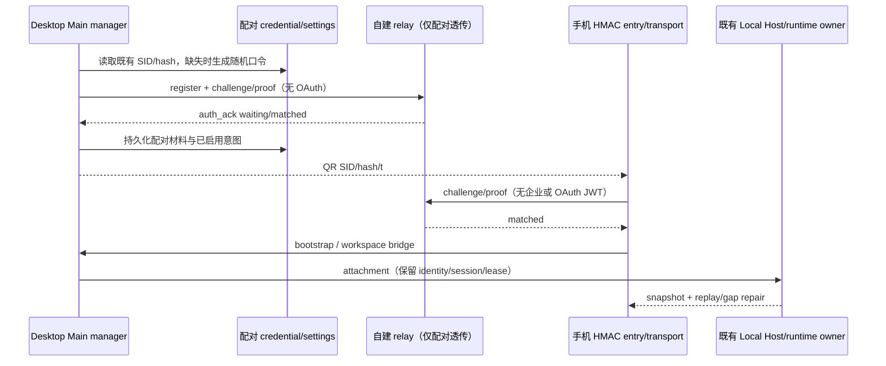
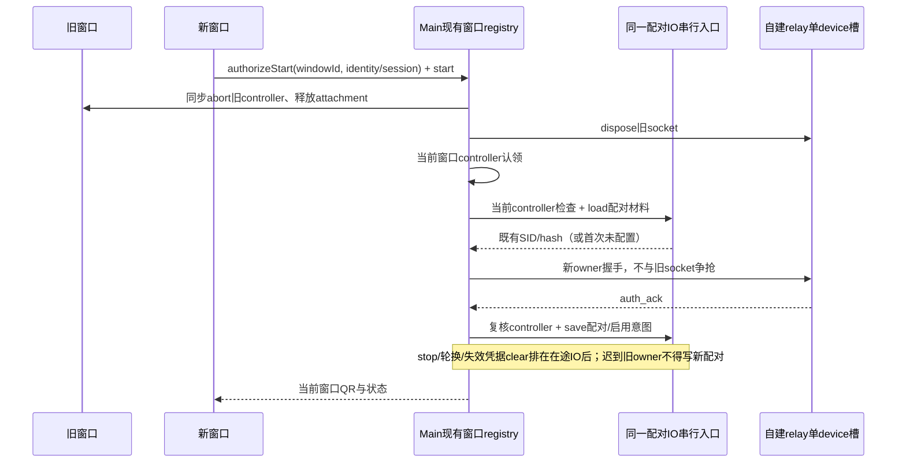

# UWork 自建 Web 远控 relay（契约）

上游远控链路里的中继（文档里的 zcode-remote-hub）在 ZCode 侧，本仓不含实现。这份契约定义 UWork 自建版本
（`packages/relay`）必须做到什么：它只是桌面与手机之间的鉴权 + 透传中继，不解析业务、不碰会话内容。

规划背景、分期与公网加固清单见 `specs/mobile-web-control-self-hosted.md`；手机侧装配规则见
`specs/web-remote-uwork-integration.md`。

> 当前源码边界（2026-10-21）：历史文档中的 `packages/relay` 实现未出现在当前 Git 基线；本轮恢复的是合并前已有的客户端 HMAC 能力，并用 loopback 测试夹具验证双端互通。本文 relay 部分仍作为外部部署协议合同，不宣称新增或发布独立 relay 服务。

## 一、产品规则与所有者

- relay **只做四件事**：设备注册、配对鉴权、心跳应答、按配对关系透传 `data`。它不解释 payload，
  不落存档，不建自己的会话模型；会话/工作区/任务的所有者仍是发起远控的那台桌面的 Local Host。
- relay **不是 Release 产物的一部分**：它不进 `packages/desktop` 依赖、不进 electron-builder、不进桌面安装包，
  只以独立容器部署。构建/部署形态见第八节。代码放本仓是因为它的契约就是本仓
  `packages/shared/src/web-remote-control.ts`（消息形状 + HMAC 测试向量 + 1 MiB 帧上限）；独立成仓只能复制这些类型，
  协议一改就漂移，这是本方案列过的头号风险。
- 客户端行为不由 relay 决定：桌面 transport 与手机 transport 已存在且不改（本次只在 relay 侧实现它们期待的服务端）。
- relay 不持有任何 UWork/企业身份：配对凭证是桌面生成的随机口令派生值，与企微身份、网关 Key、模型无关。
- 链接即控制权：`device_sid + pass_hash` 谁拿到谁能配对。relay 不做「访问控制」产品（不做企微登录、不做白名单），
  但必须实现凭证轮换语义（第六节）与按 sid 强制断开（第七节）。

## 二、协议契约

消息形状以 `@zcode/shared` 为准（`WebRemoteControlRelayOutgoingMessage` / `WebRemoteControlRelayIncomingMessage`），
本表只写 relay 行为。`server_ts` 由 relay 补齐。

| 方向           | 消息                                                | relay 行为                                                                                                                                                                       |
| -------------- | --------------------------------------------------- | -------------------------------------------------------------------------------------------------------------------------------------------------------------------------------- |
| device → relay | `device_register_init{device_mid, pass_hash, meta}` | 生成唯一 `device_sid`，落盘 `sid → pass_hash`（+ mid/meta/时间），回 `device_register_ack{device_sid}`。**不校验 pass_hash 内容**（它是客户端的随机口令派生值）                  |
| 双端 → relay   | `auth_init{role, device_sid, meta}`                 | 记录 socket 角色；`device_sid` 未知：device → `AUTH_FAILED`（桌面会重新注册），terminal → `DEVICE_OFFLINE`（手机有宽限窗口）。已知：生成一次性 nonce，回 `auth_challenge{nonce}` |
| 双端 → relay   | `auth_response{device_sid, proof}`                  | 用落盘 `pass_hash` 校验 `proof`（第三节），失败回 `error{AUTH_FAILED}`；成功回 `auth_ack{device_sid, terminal_sid?, pair_status}` 并通知对端状态变化                             |
| 双端 → relay   | `pair_status_query{device_sid}`                     | 回 `pair_status_ack{terminal_sid?, pair_status}`（8~12s 心跳；relay 不回，客户端 30s 后自行重连）                                                                                |
| 双端 → relay   | `data{payload}`                                     | 该 sid 已 `matched` 且发送方已鉴权：原样转发给同 sid 的对端（附 `server_ts`）。**没有可投递的对端时回 `error{INTERNAL}`（不断连）**。不解析、不改写、不落盘                      |
| relay → 双端   | `pair_status_ack{pair_status}`（主动推送）          | 配对关系变化时立即推给仍在线的一方（不依赖心跳轮询）                                                                                                                             |
| relay → 双端   | `error{code,message}`                               | `code ∈ AUTH_FAILED / DEVICE_OFFLINE / KICKED / WRONG_PARAM / INTERNAL`，语义见下                                                                                                |

错误码语义（与客户端已有分支一一对应）：

- `AUTH_FAILED`：注册/鉴权不通过（未知 sid 的 device、proof 错、nonce 过期）。桌面在 persisted 模式收到它会重新注册。
- `DEVICE_OFFLINE`：该 sid 上没有已鉴权的 device（未知 sid 的 terminal，或 device 掉线时推给 terminal）。
  手机据此进入可恢复窗口，超时才显示「电脑端离线」。
- `KICKED`：同一 sid 的同角色槽位被新连接顶替（第二个手机 terminal，或桌面的新 socket 顶掉旧 socket）。被顶替的一方收此错误。
- `WRONG_PARAM`：未完成鉴权阶段收到畸形/缺字段消息（JSON 解析失败、必填字段为空、未知 `type`）。
- `INTERNAL`：服务端侧问题（帧超上限被丢弃、内部异常）。**丢帧不断连**（客户端把 `INTERNAL` 当作可恢复）。

## 三、连接的鉴权状态机

```text
            ┌────────────┐  device_register_init   ┌───────────────┐
  new ──────► unauthed   ├────────────────────────►│ register_ack  │──┐
            └─────┬──────┘                         └───────────────┘  │
                  │ auth_init(role, sid)                              │
                  ▼                                                   │
            ┌────────────┐  auth_challenge  ┌────────────────┐        │
            │ challenged │◄────────────────┤ auth_init 通过 │◄───────┘
            └─────┬──────┘   (nonce,TTL)    └────────────────┘
                  │ auth_response(proof)  ──► 校验通过
                  ▼
            ┌────────────┐
            │ authenticated(role) ──► 占用该 sid 的 role 槽位
            └────────────┘
```

- `proof = base64url(HMAC-SHA256(key = pass_hash, message = "nonce|role|device_sid"))`，两侧与
  `WEB_REMOTE_CONTROL_RELAY_AUTH_PROOF_VECTORS` 必须一致；relay 侧用常量时间比较。
- nonce 一次性、带 TTL（默认 60s），失败即作废；同一连接最多 3 次 `auth_response` 尝试，超过回 `AUTH_FAILED` 并断开。
- 鉴权前不接受 `data`/`pair_status_query`（视为 `WRONG_PARAM`）。
- 鉴权后不再接受 `auth_init`/`auth_response`/`device_register_init`（视为已鉴权连接的重复握手，忽略并记日志，不降级状态）。

## 四、配对与房间

- 房间 = `device_sid`，内含两个槽位：`device`（桌面）与 `terminal`（手机）。每个槽位最多一个**已鉴权**连接。
- 同角色新连接顶掉旧连接：旧连接收 `error{KICKED}` 后关闭。这条是产品硬约束（否则两台手机能同时控制一台桌面）；
  桌面的 socket 顶替是重连正常路径（网络切换、心跳超时重建），不能因此让手机掉线。
- `pair_status`：两个槽位都在线 = `matched`；否则 `waiting`。变化即推送。
- device 离开（socket 关闭）且 terminal 在线：推 `error{DEVICE_OFFLINE}` 给 terminal，同时房间状态转 `waiting`
  （后续 `pair_status_query` 如实回 `waiting`）。terminal 离开：只转 `waiting` 并告知 device，不推错误。
- 桌面未扫码期间会持续发 `pair_status_query` 保活，因此**空闲回收只在无任何上行流量时触发**（默认 90s），
  不能把等待中的桌面判死。
- 注册但从未配对的 sid 保留（默认不过期），否则「relay 一重启/一清理，旧二维码全废」。清理交给运维（第六节）。
- 连接断开时立即释放槽位，不保留「幽灵配对」。

## 五、数据面

- `data` 只做透传：`{type:"data", payload, server_ts}`。payload 原样搬运，relay 不解析、不重排、不补 ACK。
  消息级可靠性由客户端自己的 acknowledged relay 协议负责。
- **投递不到对端时回 `error{INTERNAL}`，连接保持**：两侧客户端都把 `INTERNAL` 当可恢复信号——
  手机在已配对时降级为 waiting 并继续心跳（`enterWaitingForDeviceAfterRelayError`），
  桌面在 `paired`/`waiting_terminal` 时同样进入等待。这条是客户端注释里记录的既有上游 relay 行为
  （「转发 data 找不到 device 时只返回 INTERNAL，不会关闭当前 terminal WS」），relay 不能改成静默丢弃或断连。
- 帧上限 = `WEB_REMOTE_CONTROL_RPC_TRANSPORT_LIMITS.maxPhysicalFrameBytes`（1 MiB，`@zcode/shared` 的常量）。
  超过：丢弃该帧并回 `error{INTERNAL}`，**不断开连接**；同时给该连接一个发送缓冲上限，超限丢弃而不是无限排队。
- 支持 `permessage-deflate` 协商（大 `rpc-frame` 省带宽，客户端不支持会自动回退）。压缩开关不影响语义。
- `?mid=<device_mid>` 与 `X-Device-ID` 头只作路由/运维提示（多实例按 mid 粘滞），单实例忽略即可，不参与鉴权。
- 业务数据只在两端之间经手一次；relay 不写任何 payload 到磁盘或日志。

## 六、限制、加固与凭证生命周期

公网部署意味着 relay 必须自己扛滥用（不依赖内网可信）：

| 面        | 规则（默认值，可用环境变量覆盖）                                                                                          |
| --------- | ------------------------------------------------------------------------------------------------------------------------- |
| 并发连接  | 每 IP 并发 WS 上限（默认 32），超出拒绝并回 `WRONG_PARAM`                                                                 |
| 注册速率  | 每 IP 注册次数上限（默认 30/分钟），超出回 `WRONG_PARAM`                                                                  |
| 爆破      | 每连接 `auth_response` 失败上限 3 次；每 IP 失败计数超阈值则拒绝新连接（默认 60/10 分钟）                                 |
| 房间上限  | 存活房间数上限（默认 10_000），超出拒绝新注册                                                                             |
| 单帧/缓冲 | 1 MiB 帧上限；每连接待发送缓冲上限（默认 4 MiB）                                                                          |
| 空闲回收  | 无上行流量 90s 后关闭（等待扫码中的桌面有 8~12s 心跳，不会误杀）                                                          |
| Origin    | `terminal` 角色校验 `Origin` 属于允许列表（默认空 = 不校验，部署时必配）；`device` 无 Origin，用 `X-Device-ID`/`mid` 识别 |
| 日志      | 只记 `device_sid` 后 4 位、`role`、错误码、连接数等元数据；**不记 payload、不记完整 sid、不记 pass_hash**                 |

凭证生命周期（与桌面侧语义对齐，别在 relay 上发明新规则）：

- **停止远控不废旧链接**：桌面 `stopWindowRuntime()` 不复位持久化凭据，下次 `start()` 会带同一个 `device_sid` 回来鉴权；
  因此 relay 必须保留该 sid 的 `pass_hash`（落盘），否则会让「桌面重启后自动恢复远控」失效。
- **作废入口在桌面**：弹层「刷新二维码」→ 桌面 `resetPairing()` → 复用旧 sid 失败后用**新 sid** 重新注册；relay 侧表现为
  新 sid 出现、旧 sid 变成没人用的空房间。relay 不需要「删除」接口，但要支持按 sid 强制断开（第七节）。
- relay 重启后旧二维码仍可用 = 落盘文件的硬要求；落盘只写 `sid → {passHash, mid, meta, registeredAt, lastSeenAt}`。

## 七、运维面

- `GET /health`：`{status:"ok", rooms, connections, paired, uptimeMs, version}`，给容器健康检查用。
- `POST /admin/disconnect`：body `{deviceSid}`，带 `Authorization: Bearer <RELAY_ADMIN_TOKEN>`。
  用于已知链接泄露/异常设备时强制断开该 sid 的两端连接（token 未配置时该端点整体禁用，返回 404）。
- 优雅退出：SIGTERM/SIGINT 停止接受新连接 → 关闭现有 socket（`1001 going away`）→ flush 落盘 → exit。
- 观测建议：房间数、在线连接、配对成功率、错误码分布；排障先看配对成功率与 `DEVICE_OFFLINE` 占比。

## 八、部署形态

- 一个容器 = 一个进程，`Dockerfile` 多阶段构建：monorepo 里构建 → 运行阶段只带 `dist` 与运行期依赖。
- 与手机页同域：nginx 托管 `/remote/v4` 静态资源 + `Upgrade` 反代 `/ws` 到本容器（一张证书、无跨域）。
  静态页与 nginx 属 P2（`deploy/web-remote`），不在本次交付内。
- **反代后面必须开 `RELAY_TRUST_PROXY_HEADERS=true`**：网关把来源 IP 换成了自己，不开的话每 IP 限流会把
  全部用户算成一个桶（默认 32 连接 / 30 注册每分钟），一个人就能把别人挡在门外。开启后按
  `X-Forwarded-For` 第一跳 / `X-Real-IP` 取客户端 IP（这是防伪造前提，只能在可信反代后面打开）。
- **不进 Release**：`packages/desktop` 不依赖 `@zcode/relay`，打包脚本不引用它；relay 只参与 lint/typecheck/architecture/单测。
- 配置全部走环境变量（容器友好），不读桌面侧 runtime 配置；桌面指向自建入口属于 P3。
- 具体域名、证书路径、compose 凭据属于部署环境，**不写进本仓**。

## 九、验收与回归

1. 协议单测：注册 → 鉴权 → matched → 双向 `data` 透传 → 心跳应答；`auth_challenge` nonce 一次性。
2. 鉴权向量：直接使用 `WEB_REMOTE_CONTROL_RELAY_AUTH_PROOF_VECTORS` 校验 device/terminal 两侧 proof。
3. 错误面：`AUTH_FAILED`（未知 sid 的 device / proof 错）、`DEVICE_OFFLINE`（未知 sid 的 terminal / device 掉线推送）、
   `KICKED`（第二个 terminal）、`WRONG_PARAM`（未鉴权畸形消息）、`INTERNAL`（超限帧丢帧不断连）。
4. 配对状态推送：任一端上下线，另一端在不发心跳的情况下也能收到状态变化。
5. 限制：每 IP 连接数与注册速率、失败次数上限、房间上限、空闲回收（等待中的桌面不被误杀）。
6. 落盘：注册后重启进程，用旧 `device_sid + pass_hash` 仍能鉴权成功（旧二维码不废）。
7. 集成：真实手机端 transport（`packages/web` 的 `WebRemoteControlTerminalTransport`，注入 `ws` 作为
   `WebSocketCtor`）与真实桌面端 transport 打到真 relay，跑通配对与一次 `data` 往返。
8. 运维：`/health` 字段、`/admin/disconnect` 断开与鉴权、SIGTERM 优雅退出。
9. `pnpm typecheck`、`pnpm lint`、`architecture:check`、`oxfmt --check` 全过。

### 2026-10-17 验证记录（实现落地）

已执行：

- **协议与失败面单测 42 项全过**（`pnpm exec vitest run packages/relay`，7 个文件）：
  - `relayAuth`：与 `WEB_REMOTE_CONTROL_RELAY_AUTH_PROOF_VECTORS` 逐字节一致（两个向量 + 反例）；
    未知 sid 的 device→`AUTH_FAILED`、terminal→`DEVICE_OFFLINE`；proof 错/角色错/未握手就回 proof 全被拒。
  - `relayPairing`：注册→双侧鉴权→`matched` 推送；双向 `data` 透传 payload 不变；桌面掉线推 `DEVICE_OFFLINE` 且状态回 `waiting`；
    手机掉线只推 `waiting`；第二个手机 → 先到的收 `KICKED`；桌面用旧 sid 重连仍 `matched`（旧二维码不作废）。
  - `relayTransportLimits`：超限帧丢帧不断连、未鉴权畸形消息 `WRONG_PARAM`、已鉴权坏帧不拆会话、
    投递不到对端 `INTERNAL`、每 IP 并发/注册速率/房间上限、Origin 允许列表、空闲回收与心跳保活。
  - `relayPersistence`：重启后旧 sid 仍可鉴权；不配 `stateFile` 则失效；**落盘文件只有凭证与元数据，断言不含 payload**。
  - `relayOps`：`/health` 计数、`/admin/disconnect` 的 404/401/200 与断开效果、`close()` 以 1001 断开。
  - `relayClientContract`（集成，非 mock）：**真实手机端 transport**（`packages/web` 的
    `WebRemoteControlTerminalTransport`，注入 `ws` 作 `WebSocketCtor`）打到真 relay，跑通握手、双向收发、
    第二个手机接管时的 `session-conflict`、以及桌面掉线后的 `desktop-disconnected`。桌面侧仍由测试夹具
    按 transport 语义驱动（未起 Electron）。
- **产物与部署实测**：`pnpm --filter @zcode/relay build` 产出单文件 `dist/entry.js`（1.4 MB，自带 shared 与 ws），
  复制到空目录直接 `node entry.js` 可跑（`ws` 的动态 require 用 `createRequire` 垫片解决）；
  `docker build -t uwork-relay:smoke packages/relay` 成功，容器内以 `node` 用户运行、绑定 `0.0.0.0`，
  宿主 `curl /health` 正常；**用真实 WS 客户端对容器跑完注册→配对→透传**，
  `health` 回 `rooms:1 paired:1 connections:2 devices:1`；`docker restart` 后日志显示 `restored relay state {devices:1}`，
  即「relay 重启不作废旧二维码」在真实部署形态下成立。
- **门禁**：`pnpm typecheck`（含新登记的 `packages/relay`）exit 0；`pnpm architecture:check` 0 violations
  （relay 以 `managed: true` 登记，`module.ts`/`contract.ts`/`contract.example.ts`/`CONTRACT.md`/契约测试齐备）；
  `oxfmt --check` 干净；`pnpm lint` 中 relay 相关告警 0 条（全仓 306 条告警为既有，均为 warning 不是 error）。
- **不进 Release 已核对**：`packages/desktop` 不依赖 `@zcode/relay`，electron-builder 的 `files` 只收
  `packages/desktop/out/**` + `package.json` 并排除 `node_modules/@zcode/**`，两边没有引用关系。

### 2026-10-17 生产部署：aihub 域名（`wss://aihub.ucas.com.cn/remote/ws`）

**部署位置**（用户已定：用 aihub 域名做中转）：`192.168.100.143:/home/services/uwork-relay/`，
compose 项目 `uwork-relay`，容器 `uwork-relay` 只发布 `127.0.0.1:18002`；落盘
`data/relay-state.json`（bind mount，属主 1000/1000）。链路：`145`（对外终止 TLS，Let's Encrypt
签发的 `aihub.ucas.com.cn`，有效期到 2026-12-03，手机浏览器可接受）→ `143:18000` 的 `aihub-gateway`
→（本次新增的 `location /remote/ws`）→ `127.0.0.1:18002`。

**为什么这样接**：只发布到回环地址，因此**不需要动 firewalld**（143 的 public 区是手工白名单，
误加/丢端口都是事故），也不需要公网直连容器；外层 145 与网关都是 catch-all 反代，所以只需在
`aihub-gateway` 加一条路径。网关配置改动：新增 `map $http_upgrade $connection_upgrade` 与
`location /remote/ws`（带 `Upgrade`/`Connection`、`proxy_buffering off`、1h 读写超时）。
备份 `/etc/aihub/gateway/nginx.conf.bak-20261017-220947`；就地写文件（保 inode）+ 容器内
`grep` 核验 + `nginx -t` + `reload`，门户与 SkillHub 未受影响。

**配置**：`RELAY_TRUST_PROXY_HEADERS=true`（反代后面必须开，否则每 IP 限流退化成全局桶）、
`RELAY_ALLOWED_ORIGINS=https://aihub.ucas.com.cn`、`RELAY_ADMIN_TOKEN`（在服务器 `.env`，600；
本地索引在 `agents/uwork/.zcode/uwork-relay-deploy-2026-10-17.md`）。

**实测（公网域名，非本机直连）**：伪造 `Origin` 在升级阶段被 403 拒；桌面注册 → 桌面 `waiting` →
手机（合法 Origin）`matched` → 双向 `data` 透传 payload 原样 → 桌面掉线手机收 `DEVICE_OFFLINE`；
`/health` 在服务器侧回 `rooms/paired/connections/devices` 计数正确。验证用的测试设备已清理
（state 文件重置为空，`devices: 0`）；身边服务（ucas-proxy-prod 全套、skillhub、aihub-gateway）与
容器/网络清单核对无多余项。运维说明写在 `/home/services/uwork-relay/README.md`。

**P2/P3 也已落地（同日）**：

- **手机页托管（P2）**：`https://aihub.ucas.com.cn/remote/v4`，静态文件放在
  `/etc/aihub/gateway/html/remote/v4/`（复用网关已有的 html 挂载，**不需要重建容器**、不需要新端口）。
  构建命令：`ZCODE_BASE_URL=https://aihub.ucas.com.cn` +
  `VITE_ZCODE_WEB_REMOTE_CONTROL_RELAY_WS_URL=wss://aihub.ucas.com.cn/remote/ws` 后跑
  `pnpm run build:web-remote-control:v4`（`vite.config.ts` 用 `ZCODE_BASE_URL` 覆盖
  `VITE_ZCODE_BASE_URL`，两个都要给），发之前删掉 `*.map`（110MB/2237 个文件，且不该发布源码）。
  网关侧：`location = /remote/v4`（二维码就是这个不带尾斜杠的形状，直接伺服 index.html，不重定向以免丢 query）、
  `^~ /remote/v4/{assets,material-icons,pdfjs}/` 显式 `try_files $uri =404`（落进 SPA fallback 会拿 200 的
  index.html 伪装成成功）、`^~ /remote/v4/` 其余走 SPA fallback。
- **桌面指向自建入口（P3）**：新增随包配置 `config/mobile-remote-control.json`
  （`{remotePageBaseUrl, relayWsUrl}`，仓库内默认即 aihub），electron-builder 用 `extraResources`
  放到 `Resources/config/`；加载器 `packages/desktop/src/main/desktopMobileRemoteControlConfig.ts`
  （打包态读 `resourcesPath/config/`，dev 读仓库根 `config/`），优先级 **env > 随包配置 > ZCode 默认**。
  校验拒绝明文 http/ws（本机调试除外）、根路径页地址、带 query/hash 的地址；读不到或非法就退回默认并告警，
  绝不因为一个配置坏掉让远控不可用。桌面把这两个值用在三处：`getEndpointUrls().relayWsUrl`/`remoteUrl`
  与 manager 的 `relayWsUrl`/`mobileRemoteControlUrl`——**换 relay 必须同时换页地址**，否则二维码指向的
  还是别人的页面。

**公网实测（真实浏览器 + 真实协议）**：用 `wss://aihub.ucas.com.cn/remote/ws` 注册一个假桌面并保持在线，
在浏览器打开 `https://aihub.ucas.com.cn/remote/v4?...二维码参数...`，页面显示「Paired. Loading workspace…」；
假桌面侧收到手机端真实载荷（`mobile-diagnostic`、`bootstrap-request`），relay `/health` 回
`rooms:1 paired:1 connections:2 devices:1`。设备下线后页面进入失败态并提供 Retry。验证用的设备与状态文件
已清理（`devices:0`）。

**仍未验证**：没有跑真实桌面二进制（需要 Electron + GUI 且远控连接要点击入口才会建立），
所以「桌面读随包配置并连到自建 relay」只有单测与代码路径层面的证据；首次真实桌面运行时应看
relay 日志是否出现 `device registered`（mid 为那台机器）来确认。手机页文案仍是 ZCode 品牌（P4）。：手机页仍由 ZCode 侧托管，页面内置的 relay 地址是 z.ai 的，
桌面端二维码也还指向 `https://zcode.z.ai/remote/v4`。要真正切到本中继需要 P2（把 `packages/web`
构建的手机页托管到本域名，构建时注入 `VITE_ZCODE_WEB_REMOTE_CONTROL_RELAY_WS_URL`）与 P3
（桌面端 runtime 配置注入指到自建页与 relay）。

## 十、本次未验证 / 边界

- 未过公网：没有真实域名、证书、nginx 反代与手机蜂窝网络的端到端跑通（静态页与 `/ws` 反代属 P2）。
- 桌面侧未用真实 `webRemoteControlManager` 跑（需 Electron 运行时）；集成覆盖到 transport 层。
- `packages/relay/test/relayClientContract.test.ts` 不参与 typecheck（手机端 transport 所在包没有 `exports`
  字段且需要 DOM lib），仅由 vitest 运行——已在 `packages/relay/tsconfig.json` 注明原因。

- 未做公网真机验证：没有真实域名、证书、nginx 反代与手机蜂窝网络的端到端跑通。
- 未接入桌面端真实 `webRemoteControlManager` 全链路（需要 Electron 运行时）；集成测覆盖到 transport 层。
- 未做多实例/横向扩容：单实例内存态房间 + 落盘；要横向扩容必须按 `mid`/`device_sid` 粘滞路由。
- 容器镜像构建与 `docker compose` 冒烟取决于部署环境，若本机无容器运行时则如实记为未验证。
- 手机页静态托管与桌面配置注入（P2/P3）未做，因此当前链路仍指向 ZCode 侧入口，自建 relay 需配合 P3 才能真正切换。

## 2026-10-21 上游 V2 同步兼容修复

UWork 随包远控明确使用 `hmac-v1`，保留自建 relay 的随机口令配对；上游 OAuth V2 保留为隔离的兼容实现，不能成为 UWork 启动门禁。协议选择由桌面 Main 装配和手机构建配置拥有，不根据登录状态、URL 中的 hash 或企业身份自动降级。手机默认 HMAC；显式 `VITE_WEB_REMOTE_CONTROL_PROTOCOL=oauth-v2` 的构建保留上游门禁。自建桌面必须显式配置可信 relay/手机地址，缺失配置时失败关闭，不向官方 relay 发送 HMAC 凭据。

- 自建 relay 每个 SID 只有一个 device 槽，Main 以现有 windowLifecycles/runtimes 保持单一活动 HMAC 窗口 owner；新窗口显式 start 先同步撤销旧窗口连接与 attachment，再认领当前窗口，不额外维护 owner 副本，也不通过 KICKED 竞争。并发首次 start 只允许最新 controller 完成注册/保存。Main manager 仍拥有窗口 lifecycle、已启用意图与 Host attachment，HMAC adapter 仅拥有 socket/握手；旧 SID/配对密钥由现有 credential/settings storage 持久化，不因 OAuth 退役清除；load/save/reset 与失效凭据清理均经过同一 persistence 队列并复核当前 controller。停止保留配对，刷新二维码撤销旧 socket 后轮换凭据。
- 手机 HMAC admission 校验完整 SID/hash/t，再复用现有 bootstrap、workspaceIdentity/remoteSessionId、task-view 与 replayable bridge；无 OAuth 读取、登录或 token HTTP。只读企业 Provider 规则不变。
- V2 的二维码 parser 继续拒绝 HMAC 参数；HMAC 使用独立 builder/parser，不更改官方 V2 信任边界；企业 JWT 绝不参与 relay 配对。
- 桌面 `desktop-continuous` 与手机 `web-remote-replayable` 保持同一 runtime owner、lease 与已有 snapshot/gap repair；不创建第二份队列或 Host。



回归必须证明：无账号桌面可启动并生成 HMAC QR；手机可无登录配对并往返 data；官方 V2 无账号仍拒绝；持久化重连、stop、轮换和停止期间迟到启动不能复活；任务/工作区上游 UI 投影仍保留。真实企业微信、生产 relay 与安装包发布不由 loopback 回归代替。

### 本轮运行证据

- 共享 HMAC QR 回归先在 V2 基线观察 6 项失败，恢复独立 HMAC builder/parser 后通过；V2 parser 继续拒绝 HMAC 参数。
- 两端 HMAC transport 的既有回归 49 项通过；真实 loopback 新回归覆盖无账号配对、workspace 请求/响应、stop/持久化复用、轮换及迟到读取/保存/轮换被 stop 撤销。
- `node --test scripts/test/web-remote-uwork-integration.test.mjs`：3 项通过，覆盖全部只读入口、Host 目录与完整任务导航接线。
- browser-harness 运行 `uwork-remote-integration.mjs`：390/1200px × Zai Light/Dark 四组合通过，修复实际观察到的远控 Automations 入口误展示；只读身份、无引导、home-only 重连和无未处理 JS 异常成立。home-only 缺少真实 Host 项目/V4 服务产生预期 fail-closed 日志，不代表可聊天 runtime 或真实企业/生产 relay 验收。
- Node24.14.0 下 `pnpm typecheck` 通过（2026-10-21 16:09 这一轮）；最终聚焦测试和全仓 lint/architecture 以合并审查记录为准。

运行配置：Desktop 使用 `ZCODE_WEB_REMOTE_CONTROL_RELAY_WS_URL` 与 `ZCODE_WEB_REMOTE_CONTROL_URL`；手机构建使用 `VITE_ZCODE_WEB_REMOTE_CONTROL_RELAY_WS_URL`，默认 `VITE_WEB_REMOTE_CONTROL_PROTOCOL=hmac-v1`。官方 V2 兼容构建仅在显式选择 `oauth-v2` 时采用其原账号门禁。地址仅为部署配置，不写入示例凭据或真实内部地址。

### HMAC 单设备槽的跨窗口交接


