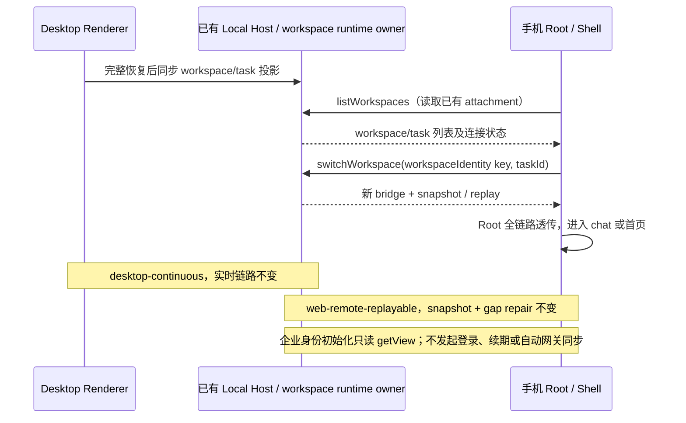

# UWork 手机远控装配修复

## 产品规则与所有者

- 手机 `/remote`（external relay、token bridge 和 disconnected home-only）只投影桌面已有 Host attachment；初始化/切换不自动恢复身份会话、不提供身份登录/退出入口、不触发自动企业网关配置。此装配标志不等于所有 RPC 的权限封禁；显式网关设置写入不在本次重构范围。
- 企业身份唯一写者仍是窗口 Local Host 的 enterprise identity service；workspace/session/runtime 及 accepted input 的所有者不变。手机不新建 Host、Agent 或独立远程会话。
- Root 将 workspace switcher、初始手机导航意图、初始 workspace/task 列表及 terminal transport 状态完整传至现有 RootWorkspaceContent → App → WorkspaceShellLayout。
- 窄屏使用现有 WebRemoteControlMobileShell；宽屏 Sidebar 使用同一个 switcher 的 listWorkspaces 全局任务索引，支持当前工作区任务和跨工作区切换。Sidebar 只保存折叠等局部 UI 状态。
- 桌面仅在远控已启用且状态 running/active、完整 workspace 恢复后发布工作区与任务列表投影；普通桌面不订阅整张 workspace 状态表。重连请求由已有桌面连接 owner 执行。
- UWork 已裁剪的 OAuth 账号、套餐、奖励及营销入口保持裁剪；远控修复不恢复这些产品入口。
- 手机 attachment 不挂载桌面首次职业/迁移引导；该偏好写入和完成状态仍属于已有桌面，不因 home-only 缺少设置而在手机上重新引导。

## 事件顺序与边界

- 身份 key 继续使用 `workspaceIdentity?.trim() || workspacePath`；跨工作区切换通过现有 switcher，不用本地路径另建路由。
- 重建 bridge 后旧 Root 卸载，现有 switcher、任务索引和 replay 机制负责 stale result 与订阅清理；不增加超时或第二份 accepted queue。

## 验收与回归

1. 三种手机 Root 均显式启用企业身份只读；初次连接、跨工作区切换或 home-only 重建不显示企业登录，不调用 restoreSession/beginLogin/网关 sync。
2. Root 透传四项远控参数；手机保持 replayable workbench 模式，桌面保持 continuous。
3. 390px 手机首页可查看任务、打开当前任务、跨工作区切换；1200px 远控 Sidebar 使用全局任务索引，调用任务打开及切换中回调，隐藏 Automations，保留插件入口。
4. disconnected home-only 显示已有 workspace 列表并可重连；新 bridge 不新建 Agent/runtime。terminal reconnecting 提示保持现有手机壳语义。
5. 桌面远控关闭时不订阅全局任务表；开启时完整恢复后同步 pinned/timeline/archived 列表，重连请求转交既有连接 owner。
6. Zai Light / Zai Dark、中文/英文沿用已有组件与 DESIGN.md；窄屏/宽屏浏览器场景记录真实执行边界。

对应验证：Root 装配回归、手机入口只读装配回归、现有 workspaceSidebarWebRemoteMobileLayout / workspaceShellRemoteMobileLayout / webRemoteControlMobileShell 回归，以及真实 Web 入口浏览器场景。不得删除或跳过失败用例。

## 桌面端入口接线（2026-10-17）

上游 v3.15.1 合并把 `WorkspaceWebRemoteControlTrigger` 组件带进来了，但**渲染点连同 footer 的账号/套餐/用量入口一起被
UWork 裁剪掉**，于是桌面侧栏看不到远控入口，而 `workspaceSidebarFooterWebRemoteControlTooltip.test.ts` 里
「入口不被二次 tooltip 包裹」这条断言一直失败。本节固定这条接线的契约。

产品规则与所有者：

- 入口只在**桌面窗口**（`isDesktop`）且当前 workspace 有 `workspacePath` 时渲染。手机远控页自身是被控端视图，
  不需要「再远控一台桌面」的入口；Web 宿主（`isDesktop = false`）一律不渲染。
- 入口的显示开关仍归 `WebRemoteControlFeatureProvider`（默认开启，Root 可整体关闭）。关闭时不进入依赖
  TabStore 的 session resolver——这条是上游既有 bugfix，接线后必须保持。
- 侧栏只做**透传**，不新增远控状态所有者：`workspacePath` 取当前 workspace；`workspaceIdentity` 沿用侧栏已有的
  active tab identity（远程 workspace 与本地同路径靠它区分）；`remoteSessionId` 取 Shell 传入的
  `workspaceRemoteSessionId`（不再丢弃），由 `useResolvedRemoteWorkspaceSessionId` 按 identity 校验后取 live session；
  `initialTaskId` 取侧栏已有的 `activeTaskId`。
- 入口位置在 footer 尾部操作区、设置按钮之前；UWork 追加的 IM 按钮插在远控入口与设置按钮之间。设置按钮保持在最后。
- 本次接线**不恢复**上游被裁剪的账号、套餐、奖励、用量入口；也不恢复「入口外包一层 tooltip」的旧写法——
  入口名称与连接状态合并由组件内部那一个 tooltip 表达。

验收与回归：

1. `packages/ui/test/workspaceSidebarFooterWebRemoteControlTooltip.test.ts` 中
   「does not wrap the remote control trigger in a second tooltip」通过（入口出现在 footer 且无 `data-tooltip-title="webRemoteControl.trigger"` 外层）。
2. `packages/ui/test/webRemoteControl*.test.ts`、`workspaceWebRemoteControlTrigger*.test.ts`、
   `workspaceSidebarWebRemoteMobileLayout.test.ts` 全过；`pnpm typecheck` 全绿。
3. 打包后桌面侧栏可见远控入口、能开弹层出二维码（需要真实桌面 + relay，见下节「验证记录」）。

## 2026-10-14 浏览器验证边界

- `node packages/web/test/e2e/manual-review/pending/uwork-remote-integration.mjs`：真实 Web main → Root → 手机壳/宽屏 Sidebar；离线 relay 夹具首次握手、已有 disconnected workspace/task 投影、手机重连请求，390px / 1200px、Zai Light / Zai Dark 四种组合通过，无页面 JS 异常。
- `node packages/ui/test/webRemoteControlUworkFlow.e2e.mjs`：真实 MobileShell 与身份 Provider；当前任务打开、同路径不同 workspaceIdentity 的跨工作区切换并落到 chat、reconnecting 提示、只读身份初始化计数通过。
- 两者均使用 browser-harness。夹具不创建 Agent/Host，不连接企业微信、真实外部 relay 或 SSH；不能据此宣称真实配对、真实模型执行或端到端 runtime 验收。
- home-only 宽屏没有真实 attachment，底层 V4 subscribe 仍会记录 fail-closed warn；此场景只确认列表/导航展示和没有未处理 JS 异常，不宣称已建立可聊天 runtime。
- 中文消息按当前英文 key 补齐上游缺失译文，保留已有 UWork 定制值；空句式前缀按合法译文处理，覆盖检查使用键是否存在。
